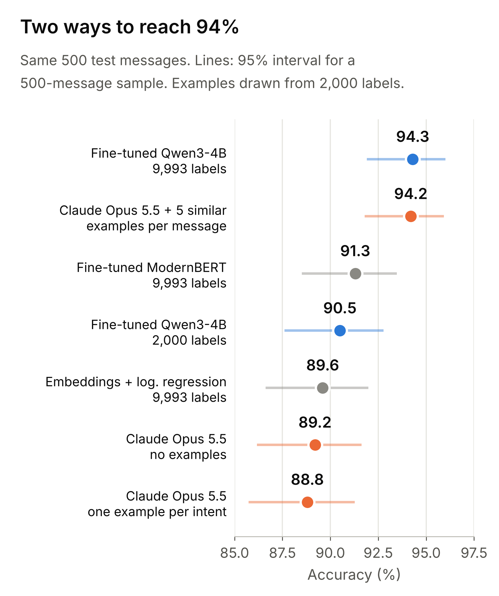
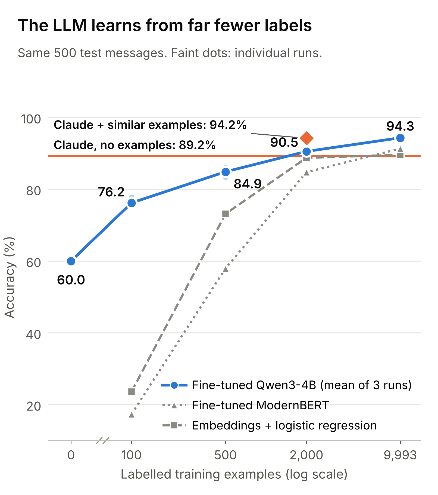
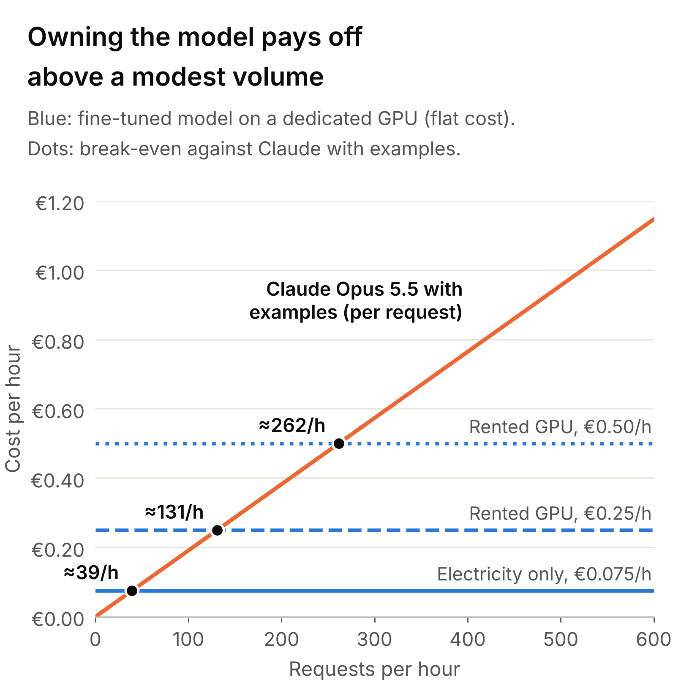

# Small fine-tuned model vs frontier LLM: Banking77 intent routing

Can a 4-billion-parameter open model, fine-tuned with LoRA on one shared 2018 GPU, match a frontier model on a narrow business task? And how much labelled data does that take?

This repository holds the code, frozen inputs, every prediction from every system, and the generated reports for a controlled comparison on [Banking77](https://huggingface.co/datasets/PolyAI/banking77): routing bank customer-support messages to one of 77 intents.

<p align="center"></p>

## Key findings

- **With all 9,993 labelled examples,** fine-tuned Qwen3-4B reached **94.3%** (± 0.5 over 3 runs). That ties Claude Opus 5.5 given the five most similar labelled examples per message (**94.2%**), and is significantly better than Claude Opus 5.5 without examples (89.2%) in every run, after Holm correction across 40 comparisons.
- **At equal data (2,000 labels),** Claude with retrieved examples beat the fine-tuned model in all three runs (94.2% vs 90.5%; significant before correction). The small model needed about five times as much labelled data to catch up.
- **The fine-tuned LLM learns from far fewer labels than classic classifiers:** 76% with 100 labels, against 17–24% for a fine-tuned ModernBERT and an embedding classifier. It stays ahead of both with the full data.
- **Most remaining errors come from the dataset.** Of the 22 messages both top systems got wrong, a manual review judged 7 to have a wrong gold label, 14 to be ambiguous and 1 to be a genuine error by both.
- **The advantage of the small model is cost and control:** about €0.002–0.012 per 1,000 requests on a dedicated GPU, against an estimated $1.91 for Claude with examples. Running it yourself pays off above roughly 40–260 requests per hour, and no message leaves your hardware.

## Results

All systems are scored on the same 500 test messages with exact-match scoring.

| System | Labelled examples | Accuracy | Latency (p50, batch 1) | Cost per 1,000 requests |
|---|---|---|---|---|
| Qwen3-4B + LoRA | 9,993 | **94.3%** ± 0.5 | 258 ms | €0.002–0.012 |
| Claude Opus 5.5, 5 retrieved examples per message | 2,000 (pool) | **94.2%** | n/a | ≈ $1.91 (CLI estimate) |
| ModernBERT-base, fine-tuned | 9,993 | 91.3% ± 0.4 | 16 ms | < €0.001 |
| Qwen3-4B + LoRA | 2,000 | 90.5% ± 1.2 | 258 ms | €0.002–0.012 |
| bge-small embeddings + logistic regression | 9,993 | 89.6% | 7 ms | < €0.001 |
| Claude Opus 5.5, no examples | 0 | 89.2% | n/a | ≈ $0.94 (CLI estimate) |
| Claude Opus 5.5, one example per intent | 77 | 88.8% | n/a | ≈ $0.66 (CLI estimate) |

± is the standard deviation over three training runs. GPU costs assume electricity only (€0.30/kWh) or a rented GPU at €0.25–0.50 per hour; Claude costs are the CLI's own list-price estimates, not bills. Claude Haiku 5.5 was also tested but often returned the wrong number of labels for a batch of 25 messages, so its scores reflect the batch format rather than the model; see the baselines report.

<p align="center"></p>

**Robustness** (models trained on 2,000 labels): both systems lose under a point on messages with typos and stay level on messages that contain two issues. To reject messages that fit no intent, the fine-tuned model needed 200 out-of-scope training examples. With them it caught 99.0% of such messages, against Claude's 99.5%.

<p align="center"></p>

## Models

| Model | What it does | Accuracy |
|---|---|---|
| [`vishal77796/qwen3-4b-banking77-full-lora`](https://huggingface.co/vishal77796/qwen3-4b-banking77-full-lora) | Trained on all 9,993 examples; always picks one of the 77 intents | 94.7% on the full test set (seed 0) |
| [`vishal77796/qwen3-4b-banking77-router-lora`](https://huggingface.co/vishal77796/qwen3-4b-banking77-router-lora) | Trained on 2,000 examples plus 200 out-of-scope examples; can answer `none_of_these` | 91.0% in scope, 99.0% out-of-scope recall |

Both are LoRA adapters (rank 16, 132 MB) for [Qwen/Qwen3-4B-Instruct-2507](https://huggingface.co/Qwen/Qwen3-4B-Instruct-2507). Usage code is on each model card.

## Reports

Every number in the reports is computed by a script from the files in `results/`; nothing is typed by hand.

- [`results/main_report.md`](results/main_report.md): label efficiency, the main Claude comparison, latency and cost.
- [`results/baselines_report.md`](results/baselines_report.md): Claude with examples, Claude Haiku, non-generative baselines, all seeds, paired tests with Holm correction, error analysis and label review.
- [`results/robustness_report.md`](results/robustness_report.md): typos, two-issue messages and out-of-scope messages.
- [`docs/robustness_fixed_choices.md`](docs/robustness_fixed_choices.md): the choices fixed before any robustness result was seen.

## How the comparison was kept fair

- The same 500 test messages for every system, drawn once with a fixed seed. Messages were sent to Claude in a shuffled order, because the test file is sorted by label and in-order batches leak that.
- Exact-match scoring; no model judges another model.
- Seeds, prompts, example selection and training settings fixed in advance; every deviation is listed in the reports.
- Examples shown to Claude come from the same 2,000 labelled messages the small model trained on.
- Paired exact McNemar tests, Wilson intervals, bootstrap intervals for differences, and Holm correction.
- Every prediction is published.

## Limitations

- One task, one dataset, English only.
- One frontier model family, called through a command-line tool with 25 messages per call, a single run and no temperature control. This is not an API benchmark.
- The best systems are close to the dataset's ceiling, so small differences between them mean little.
- Banking77 has been public since 2020 and may appear in any compared model's training data.
- The full-data model was not trained to reject out-of-scope messages. A single model doing both is untested.

## Reproduce

See [`REPRODUCE.md`](REPRODUCE.md) for exact versions and commands. In short:

```bash
pip install -r requirements.txt          # after installing the torch build for your CUDA
python finetune_qwen.py --seed 0 --budgets 0,100,500,2000
python finetune_qwen_full.py && python finetune_qwen_full.py --collect
python make_main_report.py
```

Training needs one GPU with at least 11 GB free. The 2,000-label run takes about 32 minutes, and the full training set about 2.7 hours, on a Quadro RTX 6000.

## Data and licences

Code: MIT (see [`LICENSE`](LICENSE)). The files in `results/` contain message text from two public datasets, and versions of that text modified for the robustness tests. The text stays under its original licence.

- **Banking77:** Casanueva, I., Temčinas, T., Gerz, D., Henderson, M. and Vulić, I. (2020). *Efficient Intent Detection with Dual Sentence Encoders.* 2nd Workshop on NLP for ConvAI, ACL. [Paper](https://aclanthology.org/2020.nlp4convai-1.5). Data by PolyAI, licensed [CC BY 4.0](https://creativecommons.org/licenses/by/4.0/). Loaded from the [`mteb/banking77`](https://huggingface.co/datasets/mteb/banking77) copy, a cleaned subset of the original splits: 14 duplicate or very short messages removed, leaving 9,993 training and 3,076 test messages.
- **CLINC150, out-of-scope class only:** Larson, S. et al. (2019). *An Evaluation Dataset for Intent Classification and Out-of-Scope Prediction.* EMNLP-IJCNLP 2019. [Paper](https://aclanthology.org/D19-1131). Licensed [CC BY 3.0](https://creativecommons.org/licenses/by/3.0/).

## Citation

```bibtex
@misc{jadhav2026smallvsfrontier,
  author       = {Jadhav, Vishal},
  title        = {Small fine-tuned model vs frontier LLM: Banking77 intent routing},
  year         = {2026},
  howpublished = {\url{https://github.com/Vc555s/small-vs-frontier}}
}
```
