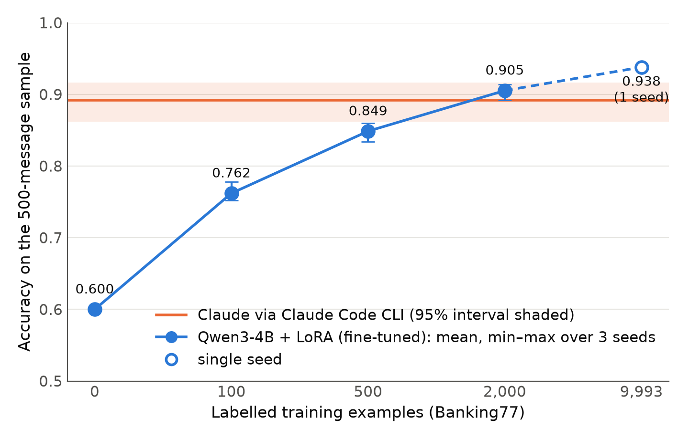
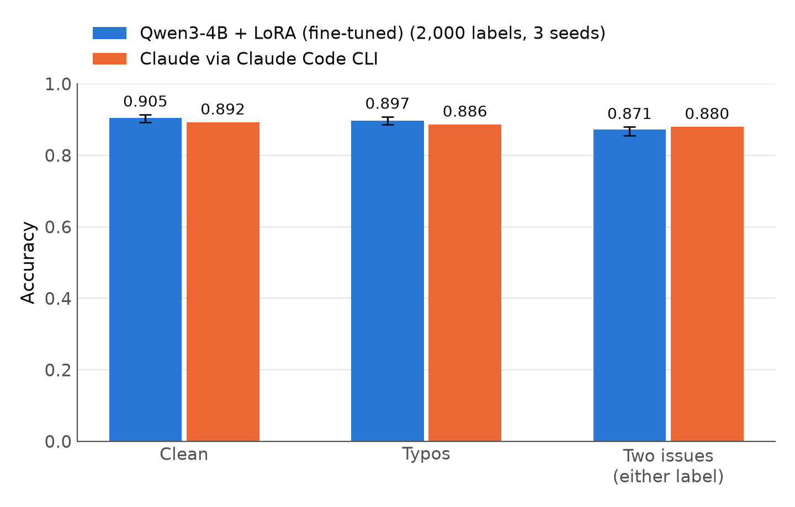
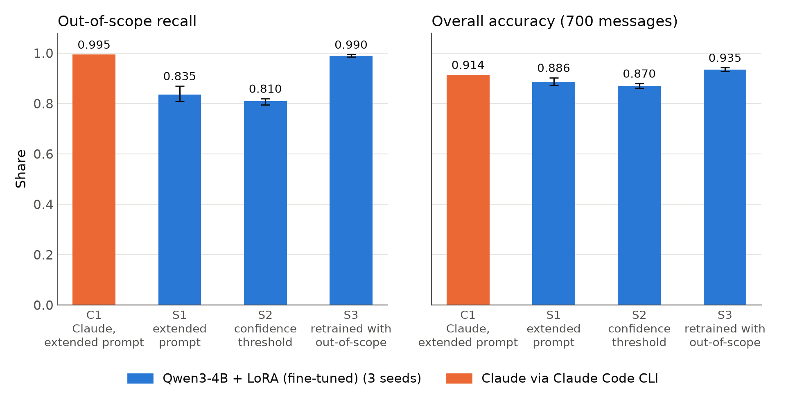

# T1 report: support-ticket routing (Banking77) — fine-tuned Qwen3-4B vs Claude via Claude Code CLI

Generated 2026-11-13 22:05 (server time) by `make_t1_report.py` from the files in `results/`. Every number below is read from those files; nothing is typed in by hand.

Contents: 1 Summary · 2 Task and data · 3 Systems · 4 Results · 5 Head-to-head on the 500 sample · 6 Procedure and issues · 7 Caveats · 8 Open work · Appendices A–E

## 1. Summary

- **Claude via Claude Code CLI (Pro subscription)**, model `claude-opus-5-5`, scored **0.892** accuracy on a fixed 500-example sample (95% Wilson CI 0.862–0.916), with every answer a valid label.
- **Fine-tuned Qwen3-4B with 2,000 labels** scored **0.905 ± 0.012** on the same 500 (3 seeds) and **0.913 ± 0.002** on the full 3,076-example test set.
- The 2,000-label gap to Claude is +1.3 points, inside Claude's confidence interval and the seed spread, and not significant in a paired test (section 5). Under the decision rule fixed in advance (differences inside the seed spread or not significant in the paired test count as ties) this is a **tie**, not a win.
- With 500 labels the small model is 4.3 points **behind** Claude; with 100 labels, further behind. The small model needs somewhere between 500 and 2,000 labels to match Claude on this 77-class task.
- The untuned model scores 0.606 on the full test set; fine-tuning gives the biggest jump at the first 100 labels.
- **Full training set (9,993 labels, one seed):** 0.938 on the 500 sample and 0.948 on the full test set; versus the 2,000-label seed-0 run +2.8 points and versus the 2,000-label 3-seed mean +3.3 points on the sample; versus Claude +4.6 points (exact McNemar p = 0.000431). A single seed cannot show run-to-run spread, so this point has no error bar.
- Run-to-run consistency and rewording stability have **not been measured yet** (section 8). Latency and cost of a merged adapter are in section 4.5.

## 2. Task and data

- Dataset: `mteb/banking77` (Hugging Face). Train 9,993 examples, test 3,076, 77 intent labels.
- Task: given one customer message, output exactly one of the 77 labels.
- Scoring: exact match after the shared `norm()` (lowercase, strip quotes/punctuation, spaces and hyphens to underscores). Any answer that is not an allowed label counts as wrong. Macro-F1 via scikit-learn over the 77 labels, invalid answers mapped to a non-label.
- The test set is **sorted by label** (the label changes 76 times in 3,075 transitions). This matters for batching (section 6.4).
- 500-example comparison sample: `sorted(random.Random(123).sample(range(3076), 500))`, saved in `results/sample500.json` and used for every system.

## 3. Systems

### 3.1 Small model (yours): Qwen3-4B-Instruct-2507, untuned and LoRA fine-tuned

| Setting | Value |
|---|---|
| Base model | `Qwen/Qwen3-4B-Instruct-2507`, fp16 weights |
| Fine-tuning | LoRA rank 16, alpha 32, dropout 0.05, `target_modules="all-linear"` (33.0M trainable params, 0.81%) |
| Optimiser | AdamW, lr 2e-4, weight decay 0, linear decay with 6% warmup, grad clip 1.0 |
| Batch | 4 per step × 2 accumulation = effective 8 |
| Epochs | 5 for budget 100, 3 for budgets 500 and 2000 |
| Precision | fp16 autocast + GradScaler (Turing GPU, no bf16); loss computed in fp32 |
| Loss | answer tokens only (label + `<|im_end|>`), prompt masked |
| Memory fixes | gradient checkpointing; logits computed only on the answer positions (`logits_to_keep`). Neither changes the maths (section 6.1) |
| Training subsets | class-balanced round-robin sample, seeded by the run seed |
| Seeds | 0, 1, 2 for each fine-tuned budget; budget 0 (untuned, greedy) run once |
| Decoding | greedy, max 16 new tokens, eval batch 16, one message per prompt |
| Prompt | the same system prompt (task line + 77 labels) for untuned and fine-tuned models |
| Hardware | 1× Quadro RTX 6000 24 GB (shared with other users), peak 9.6 GB |

Software: Python 3.11.15, torch 2.15.0+cu132, transformers 5.22.2, peft 0.21.2, datasets 5.2.0, accelerate 1.15.0, scikit-learn 1.9.1. Driver 580.178.04, CUDA 13.0.

### 3.2 Claude via Claude Code CLI (Pro subscription)

| Setting | Value |
|---|---|
| Answering model | `claude-opus-5-5` (as reported by the CLI for all 20 calls; not chosen, it is what the plan served) |
| Side model | `claude-haiku-5-5`: a small call the CLI makes itself; it does not produce the answers |
| CLI | `2.1.322 (Claude Code)`, the binary bundled with the Cursor extension (no `claude` on PATH) |
| Flags | `-p --output-format json --system-prompt <ours> --tools "" --safe-mode --strict-mcp-config --disable-slash-commands --no-session-persistence --permission-prompts none` |
| Isolation | each call a fresh process in a new empty temp dir (checked empty before and after); no tools; no CLAUDE.md, memory, skills, hooks or MCP; message texts only, gold labels never sent |
| Prompt | `system_prompt(labels)` from `exp1_routing.py` unchanged, plus one paragraph asking for a 25-item JSON array |
| Batching | 25 messages per call, 20 calls; batches from a `random.Random(456)` shuffle of the 500 (section 6.4) |
| Temperature | not settable through the CLI |
| Run date | 2026-11-13 |

The exact prompt text sent:

```
You route customer messages for a bank's support desk. Reply with exactly one label from the list below and nothing else.

Labels:
Refund_not_showing_up
activate_my_card
age_limit
apple_pay_or_google_pay
atm_support
automatic_top_up
balance_not_updated_after_bank_transfer
balance_not_updated_after_cheque_or_cash_deposit
beneficiary_not_allowed
cancel_transfer
card_about_to_expire
card_acceptance
card_arrival
card_delivery_estimate
card_linking
card_not_working
card_payment_fee_charged
card_payment_not_recognised
card_payment_wrong_exchange_rate
card_swallowed
cash_withdrawal_charge
cash_withdrawal_not_recognised
change_pin
compromised_card
contactless_not_working
country_support
declined_card_payment
declined_cash_withdrawal
declined_transfer
direct_debit_payment_not_recognised
disposable_card_limits
edit_personal_details
exchange_charge
exchange_rate
exchange_via_app
extra_charge_on_statement
failed_transfer
fiat_currency_support
get_disposable_virtual_card
get_physical_card
getting_spare_card
getting_virtual_card
lost_or_stolen_card
lost_or_stolen_phone
order_physical_card
passcode_forgotten
pending_card_payment
pending_cash_withdrawal
pending_top_up
pending_transfer
pin_blocked
receiving_money
request_refund
reverted_card_payment?
supported_cards_and_currencies
terminate_account
top_up_by_bank_transfer_charge
top_up_by_card_charge
top_up_by_cash_or_cheque
top_up_failed
top_up_limits
top_up_reverted
topping_up_by_card
transaction_charged_twice
transfer_fee_charged
transfer_into_account
transfer_not_received_by_recipient
transfer_timing
unable_to_verify_identity
verify_my_identity
verify_source_of_funds
verify_top_up
virtual_card_not_working
visa_or_mastercard
why_verify_identity
wrong_amount_of_cash_received
wrong_exchange_rate_for_cash_withdrawal

You will receive 25 numbered customer messages. Return only a JSON array of exactly 25 strings, where item i is the label for message i, in order. Use only labels from the list. No explanations, no markdown.
```

## 4. Results

### 4.1 Small model, full test set (3,076 examples), every run

| Budget | Seed | Epochs | Accuracy | Valid-label rate | Train s | Eval s | ms/example* | Peak GB |
|---|---|---|---|---|---|---|---|---|
| 0 | 0 | 0 | 0.6057 | 0.9685 | 0 | 251 | 81.7 | 9.2 |
| 100 | 0 | 5 | 0.7578 | 0.9915 | 158 | 342 | 111.3 | 9.6 |
| 100 | 1 | 5 | 0.7585 | 0.9941 | 161 | 338 | 109.7 | 9.6 |
| 100 | 2 | 5 | 0.7585 | 0.9941 | 161 | 360 | 117.0 | 9.6 |
| 500 | 0 | 3 | 0.8625 | 0.9997 | 480 | 337 | 109.6 | 9.6 |
| 500 | 1 | 3 | 0.8453 | 0.9984 | 479 | 338 | 110.0 | 9.6 |
| 500 | 2 | 3 | 0.8576 | 0.9984 | 479 | 353 | 114.8 | 9.6 |
| 2000 | 0 | 3 | 0.9138 | 1.0000 | 1925 | 333 | 108.1 | 9.6 |
| 2000 | 1 | 3 | 0.9148 | 0.9997 | 1912 | 333 | 108.1 | 9.6 |
| 2000 | 2 | 3 | 0.9106 | 1.0000 | 1909 | 330 | 107.3 | 9.6 |
| 9993 | 0 | 3 | 0.9477 | 0.9997 | 9593 | 332 | 107.9 | 9.6 |

\* eval time ÷ examples at eval batch 16, adapter not merged. **Not** batch-1 latency.

### 4.2 Small model, full test set, mean ± sample std over seeds

| Budget | Runs | Accuracy | Macro-F1 | Valid-label rate | Mean train time |
|---|---|---|---|---|---|
| 0 | 1 | 0.6057 | 0.5940 | 0.9685 | 0.0 min |
| 100 | 3 | 0.7583 ± 0.0004 | 0.7532 ± 0.0021 | 0.9932 ± 0.0015 | 2.7 min |
| 500 | 3 | 0.8551 ± 0.0089 | 0.8542 ± 0.0086 | 0.9988 ± 0.0008 | 8.0 min |
| 2000 | 3 | 0.9131 ± 0.0022 | 0.9129 ± 0.0021 | 0.9999 ± 0.0002 | 31.9 min |
| 9993 | 1 | 0.9477 | 0.9478 | 0.9997 | 159.9 min |

At budget 100, seeds 1 and 2 have identical accuracy (0.7585). This was checked: their training subsets share only 2 of 100 examples and their predictions differ on 644 test items, so the match is a coincidence.

### 4.3 Label efficiency on the full test set

| Labels | Accuracy (mean) | Gain over previous budget |
|---|---|---|
| 0 | 0.6057 |  |
| 100 | 0.7583 | +15.3 pts |
| 500 | 0.8551 | +9.7 pts |
| 2000 | 0.9131 | +5.8 pts |
| 9993 (1 seed) | 0.9477 | +3.5 pts |

Accuracy on the 500-message sample against the number of labels, with Claude's accuracy and its 95% interval (`make_figures.py`). The 9,993-label point is a single seed (hollow marker).



### 4.4 Training loss

Loss is logged every 20 optimiser steps and is a single-batch value, so it is noisy. Every logged step is in Appendix B (from `results/train_loss_t1.json`). Final logged loss per run:

| Budget | Seed | Steps | Final logged loss |
|---|---|---|---|
| 100 | 0 | 63/63 | 0.0002 |
| 100 | 1 | 63/63 | 0.0001 |
| 100 | 2 | 63/63 | 0.0012 |
| 500 | 0 | 188/188 | 0.0004 |
| 500 | 1 | 188/188 | 0.2005 |
| 500 | 2 | 188/188 | 0.0002 |
| 2000 | 0 | 750/750 | 0.0003 |
| 2000 | 1 | 750/750 | 0.1190 |
| 2000 | 2 | 750/750 | 0.0006 |
| 9993 | 0 | 3749/3749 | 0.0001 |

### 4.5 Latency and cost

Measured on the merged out-of-scope adapter (S3, seed 0; same base model and LoRA settings, extended prompt), fp16, greedy decoding, max 16 new tokens, 455 prompt tokens on average, 200 messages after 20 warm-up requests (`measure_latency.py`). **The card (Quadro RTX 6000) was shared:** 3 other processes held 10.5 GB and the card was at 54% utilisation when the measurement started, so these are not best-case numbers.

| Measure | Value |
|---|---|
| Batch size 1, end to end (tokenise + generate + decode) | p50 258.2 ms · p95 350.7 ms · p99 442.5 ms · mean 258.5 ms |
| Throughput, batch 8 | 9.45 messages/s (peak 8.31 GB) |
| Throughput, batch 16 | 11.19 messages/s (peak 9.12 GB) |
| Throughput, batch 32 | 11.52 messages/s (peak 10.74 GB) |
| Mean power during the batch-16 run (whole card) | 251 W |
| Sanity check: merged vs saved unmerged predictions | 191 vs 191 correct of 200; 200 identical predictions |

Cost per 1,000 requests (`compute_cost.py`). **Every hourly rate is an assumption, not a quoted market price.**

| System | Assumed rate | Cost per 1,000 requests | Break-even volume |
|---|---|---|---|
| Qwen3-4B + LoRA, batch 16 | energy only: measured 251 W at EUR 0.3/kWh (EUR 0.075/h) | EUR 0.0019 | 80 requests/hour |
| Qwen3-4B + LoRA, batch 16 | illustrative rental at EUR 0.25/GPU-hour (EUR 0.250/h) | EUR 0.0062 | 265 requests/hour |
| Qwen3-4B + LoRA, batch 16 | illustrative rental at EUR 0.50/GPU-hour (EUR 0.500/h) | EUR 0.0124 | 530 requests/hour |
| Claude via Claude Code CLI (Pro subscription) | the Claude Code CLI's list-price estimate with 25 messages per call and prompt caching; not a measured API bill, and not a charge on a subscription | USD 0.94 | n/a |

A dedicated GPU costs the same whether it handles 10 or 10,000 requests an hour, so the small model is cheaper only above the break-even volume = hourly GPU rate / Claude cost per request. The break-even volumes treat 1 USD as 1 EUR (a simplification; scale by your own exchange rate). At batch 16 the measured maximum is 40,284 requests per hour.

### 4.6 Robustness at a glance

Details, paired tests and caveats are in `results/t1_robustness.md`.





## 5. Head-to-head on the same 500 examples

| System | Label budget | Accuracy | Macro-F1 | Valid-label rate | Runs |
|---|---|---|---|---|---|
| Claude via Claude Code CLI (Pro subscription) | prompted | 0.892 (95% Wilson CI 0.862–0.916) | 0.891 | 1.000 | 1 |
| Qwen3-4B-Instruct-2507 untuned | 0 | 0.600 | 0.566 | 0.972 | 1 seed(s) |
| Qwen3-4B-Instruct-2507 LoRA | 100 | 0.762 ± 0.014 | 0.749 ± 0.017 | 0.997 ± 0.002 | 3 seed(s) |
| Qwen3-4B-Instruct-2507 LoRA | 500 | 0.849 ± 0.013 | 0.847 ± 0.012 | 0.999 ± 0.001 | 3 seed(s) |
| Qwen3-4B-Instruct-2507 LoRA | 2000 | 0.905 ± 0.012 | 0.901 ± 0.007 | 1.000 ± 0.000 | 3 seed(s) |
| Qwen3-4B-Instruct-2507 LoRA | 9993 | 0.938 | 0.935 | 1.000 | 1 seed(s) |

Per seed on the 500 sample:

| Budget | Seed | Accuracy | Macro-F1 | Valid |
|---|---|---|---|---|
| 0 | 0 | 0.600 | 0.566 | 0.972 |
| 100 | 0 | 0.756 | 0.741 | 0.998 |
| 100 | 1 | 0.752 | 0.738 | 0.994 |
| 100 | 2 | 0.778 | 0.768 | 0.998 |
| 500 | 0 | 0.852 | 0.853 | 1.000 |
| 500 | 1 | 0.834 | 0.833 | 0.998 |
| 500 | 2 | 0.860 | 0.856 | 1.000 |
| 2000 | 0 | 0.910 | 0.906 | 1.000 |
| 2000 | 1 | 0.914 | 0.905 | 1.000 |
| 2000 | 2 | 0.892 | 0.893 | 1.000 |
| 9993 | 0 | 0.938 | 0.935 | 1.000 |

### 5.1 Paired comparison with Claude (exact McNemar test, two-sided)

Each row compares one small-model run with Claude on the same 500 items. *Small only* = small model right, Claude wrong; *Claude only* = the reverse.

| Budget | Seed | Both right | Small only | Claude only | Both wrong | p-value |
|---|---|---|---|---|---|---|
| 0 | 0 | 297 | 3 | 149 | 51 | 2.05e-40 |
| 100 | 0 | 369 | 9 | 77 | 45 | 1.34e-14 |
| 100 | 1 | 370 | 6 | 76 | 48 | 1.57e-16 |
| 100 | 2 | 376 | 13 | 70 | 41 | 1.33e-10 |
| 500 | 0 | 406 | 20 | 40 | 34 | 0.0135 |
| 500 | 1 | 401 | 16 | 45 | 38 | 0.000264 |
| 500 | 2 | 412 | 18 | 34 | 36 | 0.0365 |
| 2000 | 0 | 428 | 27 | 18 | 27 | 0.233 |
| 2000 | 1 | 427 | 30 | 19 | 24 | 0.152 |
| 2000 | 2 | 425 | 21 | 21 | 33 | 1 |
| 9993 | 0 | 437 | 32 | 9 | 22 | 0.000431 |

Reading: at budgets 0–500 Claude is significantly better in every run. At 2,000 labels no run differs significantly from Claude; this supports calling it a tie, not a win. (Three seeds are tested separately, so treat p-values near 0.05 with care.) The 9,993-label row is a single seed; read its p-value as one run, not as a robust result.

### 5.2 Where they disagree (budget 2000, seed 0 vs Claude)

53 of 500 items get different answers. All of them:

| Test idx | Gold | Small (n=2000, s0) | Claude | Message |
|---|---|---|---|---|
| 41 | card_linking | **card_linking** | activate_my_card | I would like to reactivate my card. |
| 156 | card_payment_wrong_exchange_rate | **card_payment_wrong_exchange_rate** | exchange_rate | How can I check the exchange rate applied to my transaction? |
| 246 | fiat_currency_support | reverted_card_payment? | receiving_money | There is an incoming payment into my account, but it is deactivated. Will they still be processed? |
| 255 | fiat_currency_support | receiving_money | exchange_via_app | How do I change currencies to euros? |
| 437 | exchange_via_app | fiat_currency_support | **exchange_via_app** | Can I exchange currencies with my account? |
| 461 | lost_or_stolen_card | compromised_card | **lost_or_stolen_card** | I think I lost my card . I dont know how long it has been missing. Can you see if maybe someone else has been using it? |
| 550 | pin_blocked | change_pin | **pin_blocked** | Can I reactivate my PIN? |
| 554 | pin_blocked | compromised_card | **pin_blocked** | My card's frozen, what can I do? |
| 598 | contactless_not_working | **contactless_not_working** | apple_pay_or_google_pay | Should i reinstall the payment app? |
| 599 | top_up_by_bank_transfer_charge | **top_up_by_bank_transfer_charge** | receiving_money | how much do you charge to accept transfers |
| 629 | top_up_by_bank_transfer_charge | **top_up_by_bank_transfer_charge** | transfer_timing | Please tell me about SWIFT transfers at this bank. |
| 665 | pending_top_up | top_up_reverted | top_up_failed | OMG!  I'm trying to load my card and it wont top up!  I desperately need the money either on my card or in my bank, where is it? |
| 670 | pending_top_up | top_up_failed | **pending_top_up** | It doesn't look like the top-up completed. |
| 774 | wrong_amount_of_cash_received | declined_cash_withdrawal | **wrong_amount_of_cash_received** | My cash withdrawal was partly declined |
| 795 | wrong_amount_of_cash_received | wrong_exchange_rate_for_cash_withdrawal | **wrong_amount_of_cash_received** | Why did I get less money than I asked for? |
| 866 | transfer_not_received_by_recipient | **transfer_not_received_by_recipient** | pending_transfer | Is there a reason why my transaction is taking so long? |
| 873 | transfer_not_received_by_recipient | **transfer_not_received_by_recipient** | transfer_timing | How long do transfers need to come through? I sent some money to a friend, she needs it urgently, but seems it's still not there yet after a couple hours. |
| 1050 | balance_not_updated_after_cheque_or_cash_deposit | **balance_not_updated_after_cheque_or_cash_deposit** | pending_top_up | I made a deposit this morning but it is still pending? |
| 1052 | balance_not_updated_after_cheque_or_cash_deposit | balance_not_updated_after_bank_transfer | **balance_not_updated_after_cheque_or_cash_deposit** | I have paid money into my account but it doesn't show. |
| 1086 | card_payment_not_recognised | direct_debit_payment_not_recognised | **card_payment_not_recognised** | there is a transaction on my account that i didnt make |
| 1089 | card_payment_not_recognised | **card_payment_not_recognised** | compromised_card | Has someone accessed my card there are payments I did not make that are showing up on the app. |
| 1103 | card_payment_not_recognised | **card_payment_not_recognised** | compromised_card | What can I do about some payments on my card I didn't make.  Please put a freeze on my card till we can figure this out. |
| 1167 | why_verify_identity | **why_verify_identity** | verify_my_identity | Do I have to do an identity check? |
| 1192 | why_verify_identity | **why_verify_identity** | verify_my_identity | Do I need to verify my identity each time I wish to use my account? |
| 1222 | unable_to_verify_identity | why_verify_identity | **unable_to_verify_identity** | What's with not verifying my Id? |
| 1254 | get_physical_card | **get_physical_card** | change_pin | About this card PIN? |
| 1313 | visa_or_mastercard | card_acceptance | supported_cards_and_currencies | What major card payments are accepted? |
| 1319 | topping_up_by_card | reverted_card_payment? | card_payment_not_recognised | WHERE IS MY MONEY I WAS USING MY CARD AND IT DISAPPEARED |
| 1329 | topping_up_by_card | card_payment_fee_charged | pending_top_up | Where's the money that got charged to my card? It's not showing up in my account balance |
| 1334 | topping_up_by_card | **topping_up_by_card** | transfer_into_account | Can I give my friends access to my account so they can top it up for me? |
| 1355 | topping_up_by_card | **topping_up_by_card** | pending_top_up | Why don't I see my top up in my wallet? |
| 1392 | disposable_card_limits | get_disposable_virtual_card | **disposable_card_limits** | What can I use a virtual disposable card for? |
| 1482 | direct_debit_payment_not_recognised | **direct_debit_payment_not_recognised** | compromised_card | im so mad right now. theres several charges that I think my x boyfriend made on my card. the companys on the website wouldn't refund me my money, they told me to contact my bank. DO something please. |
| 1488 | direct_debit_payment_not_recognised | **direct_debit_payment_not_recognised** | extra_charge_on_statement | Weird charges are appearing in my debit account. |
| 1514 | direct_debit_payment_not_recognised | **direct_debit_payment_not_recognised** | extra_charge_on_statement | I was charged on my account that shouldn't be there. |
| 1558 | declined_cash_withdrawal | pending_cash_withdrawal | **declined_cash_withdrawal** | My withdrawal was cancelled. |
| 1602 | pending_card_payment | **pending_card_payment** | declined_card_payment | Why has my payment not gone through? |
| 1688 | request_refund | **request_refund** | cancel_transfer | Please stop my purchase. |
| 1820 | declined_card_payment | card_not_working | **declined_card_payment** | My card was not accepted. |
| 1839 | pending_transfer | transfer_not_received_by_recipient | **pending_transfer** | Why is my transfer not done yet? |
| 1870 | pending_transfer | transfer_not_received_by_recipient | balance_not_updated_after_bank_transfer | Why is a money transfer not showing? |
| 2049 | transfer_timing | balance_not_updated_after_bank_transfer | **transfer_timing** | Will my transfer immediately show up in my account? |
| 2179 | beneficiary_not_allowed | **beneficiary_not_allowed** | declined_transfer | Why did I receive an error message saying that my transfer was not possible? |
| 2205 | transfer_fee_charged | top_up_by_bank_transfer_charge | **transfer_fee_charged** | What is the maximum I can transfer before I incur fees? |
| 2283 | failed_transfer | reverted_card_payment? | **failed_transfer** | Can you help me figure out what's happening? I'm trying to transfer money to a friend but it keeps getting returned. I'm not sure what i'm doing wrong. |
| 2312 | failed_transfer | **failed_transfer** | declined_transfer | Why didn't my transfer go through? |
| 2313 | failed_transfer | **failed_transfer** | declined_transfer | I've attempted to do a very standard transfer and have tried 5 times at this point. Can you tell me what the issue is? Is the system down? |
| 2347 | transfer_into_account | **transfer_into_account** | transfer_timing | How does a transfer work? |
| 2462 | top_up_by_cash_or_cheque | topping_up_by_card | supported_cards_and_currencies | What methods can I use to top up my account? |
| 2600 | get_disposable_virtual_card | **get_disposable_virtual_card** | getting_virtual_card | how do VR cards work |
| 2646 | top_up_failed | **top_up_failed** | verify_top_up | How can I check to see if my top-up worked? |
| 2936 | card_about_to_expire | **card_about_to_expire** | order_physical_card | going to need a new card what are the fees and time it takes |
| 3075 | country_support | card_acceptance | **country_support** | Can the card be mailed and used in Europe? |

Bold = matches gold.

## 6. Procedure, issues and fixes (chronological)

### 6.1 Smoke test of `exp1_routing.py` (2026-11-13, 01:36–01:52)

The script had never run on a GPU. The smoke test found that the data, chat template, `dtype=` loading and `all-linear` LoRA all worked, and that untuned accuracy was well above chance. Training ran out of GPU memory twice on the shared card (about 13.8 GB free):

1. OOM in the LoRA backward pass. Fix: gradient checkpointing (trades compute for memory; same maths). `--load4bit` was rejected because it would change the model being compared.
2. OOM on a 1.11 GiB allocation: logits over the 151,936-token vocabulary at every prompt position, although loss uses only the ~7 answer positions. Fix: request logits only for the last k+1 positions (`logits_to_keep`) and compute the same cross-entropy in fp32. Also set `PYTORCH_CUDA_ALLOC_CONF=expandable_segments:True`.

The loss mask was verified: answer tokens are `['lost', '_or', '_st', 'olen', '_card', '<|im_end|>', 'Ċ']` for the label `lost_or_stolen_card`; everything before is masked. Peak memory fell to 9.4 GB.

### 6.2 Fine-tuning runs (01:53–04:57)

Run on GPU 1 with:

```bash
cd ~/slm-study && source .venv/bin/activate && mkdir -p results
for s in 0 1 2; do
  b="100,500,2000"; [ $s -eq 0 ] && b="0,100,500,2000"
  CUDA_VISIBLE_DEVICES=1 python exp1_routing.py --seed $s --budgets $b 2>&1 | tee results/exp1_log_s$s.txt
done
```

All 10 runs finished with no errors, NaNs or OOMs. Logged training loss: Appendix B.

### 6.3 Claude CLI checks before the run

- `claude` was not on PATH; the Claude Code binary bundled with the Cursor extension was used.
- `claude --help` was read for the installed version. Every needed capability had a flag except a turn limit (no `--max-turns`). With all tools disabled only one turn is possible; the script rejects any call where `num_turns != 1`, and all 20 had `num_turns = 1`.
- A probe call with a 15-character system prompt was billed as ~789 prompt tokens, so the CLI adds its own text even with `--system-prompt`.

### 6.4 Batch-order change

The 500 sample indices were first batched in index order. A one-batch test in that order scored 24/25, but showed the batch held only 4 intents in long same-label runs, because the test set is sorted by label. Across the 20 index-order batches there were only 4–7 distinct labels per batch. That gives Claude context from neighbouring messages that the one-at-a-time small model never gets. That first batch's raw answer, for the record (files since deleted):

```json
["card_arrival","card_arrival","card_arrival","card_arrival","card_arrival","card_arrival","activate_my_card","card_linking","card_linking","card_linking","card_linking","card_linking","card_linking","card_linking","card_linking","exchange_rate","exchange_rate","exchange_rate","exchange_rate","exchange_rate","exchange_rate","exchange_rate","exchange_rate","card_payment_wrong_exchange_rate","card_payment_wrong_exchange_rate"]
```

Fix: the same 500 indices shuffled once with `random.Random(456)` (`results/sample500_batch_order.json`), then split into 20 batches. Distinct labels per batch after the shuffle: 18–24. The first test's predictions and raw output were deleted and all 20 batches rerun. The 24/25 from the discarded batch is not used anywhere. Prompt wording and scoring were not changed.

### 6.5 Claude run (02:17–02:21)

20/20 batches returned a valid 25-item array on the first attempt: 0 retries, 0 failures, 0 rate limits. Wall time per call 3.9–9.9 s (median 6.8 s), including CLI start-up and network. Answering-model tokens over 20 calls: input 40, cache-creation 24,454, cache-read 17,340, output 13,427. The CLI's own list-price estimate was $0.47 in total; on a Pro plan this is not a charge, and it is not an API cost measurement. Per-call summary: Appendix C; every raw answer: Appendix D.

### 6.6 Full-training-set run

Budget 9,993 (the whole training set, checked to contain every training example exactly once and no test item), seed 0, 3 epochs, same hyperparameters as every other run, via `full_data.py`, which runs `exp1_routing.py --budgets 9993 --seed 0` unchanged. Training took 2.7 hours; evaluation on the full test set 6 minutes. One seed only.

## 7. Caveats (read before quoting any number)

- **Claude saw 25 messages per call**; the small model saw one at a time. Mixed batches still give Claude some context across messages.
- The Claude Code CLI wraps our system prompt in some text of its own and makes a side call to `claude-haiku-5-5`.
- **Claude's temperature could not be set**; the small model used greedy decoding.
- Claude's model is whatever the Pro plan served (`claude-opus-5-5`), not a chosen API model. This is **one Claude model through one CLI. It is not an API baseline** and says nothing about GPT or other frontier models.
- Claude was run once on the 500 sample; its CI reflects sampling of test items, not run-to-run variation.
- Claude's wall time includes CLI start-up and network and is not model latency. The small model's ms/example is at eval batch 16 with an unmerged adapter. **Neither is a latency measurement**; batch-1 latency of a merged adapter is in section 4.5.
- Some Banking77 intents overlap (for example, the test message "I would like to reactivate my card" is labelled `card_linking`, not `activate_my_card`), so some errors may be label ambiguity rather than model mistakes. This was observed, not measured.
- The 500-sample comparison has wider error bars than the full-test-set numbers; the small model's full-set numbers are more precise but have no Claude counterpart.
- Budget 0 was run once (greedy decoding is deterministic, so other seeds would match).
- The full-training-set budget (9,993 labels) was run with one seed only, so it shows no run-to-run spread.

## 8. Open work

- Consistency test: first 100 sample items × 5 runs for Claude (20 more calls) and for the 2,000-label model.
- Rewording stability: 3–5 paraphrased instructions.
- API baselines (Claude API, GPT).
- A second dataset, to test whether the label-efficiency curve transfers.

---

## Appendix A. About this public version

The smoke-test notes, raw run logs, full Claude CLI JSON for every call, GPU process list and version-control history contain server, account and session details and are not published. Everything they were used for is kept here in identifier-free form: logged training loss (`results/train_loss_t1.json`), a per-call summary of the Claude CLI output (`results/claude_calls_t1.json`), and every prediction. Every number in sections 1–8 is computed from the published files.

## Appendix B. Training loss, every logged step

Single-batch loss logged every 20 optimiser steps by `exp1_routing.py`.

### B.1 seed 0

| Budget | Epoch | Step | Loss | Elapsed s |
|---|---|---|---|---|
| 100 | 2/5 | 20/63 | 0.2526 | 49 |
| 100 | 4/5 | 40/63 | 0.0087 | 98 |
| 100 | 5/5 | 60/63 | 0.0001 | 147 |
| 100 | 5/5 | 63/63 | 0.0002 | 155 |
| 500 | 1/3 | 20/188 | 0.4179 | 51 |
| 500 | 1/3 | 40/188 | 0.0431 | 102 |
| 500 | 1/3 | 60/188 | 0.2666 | 153 |
| 500 | 2/3 | 80/188 | 0.2043 | 203 |
| 500 | 2/3 | 100/188 | 0.0007 | 255 |
| 500 | 2/3 | 120/188 | 0.0659 | 306 |
| 500 | 3/3 | 140/188 | 0.0139 | 356 |
| 500 | 3/3 | 160/188 | 0.0015 | 407 |
| 500 | 3/3 | 180/188 | 0.0019 | 458 |
| 500 | 3/3 | 188/188 | 0.0004 | 478 |
| 2000 | 1/3 | 20/750 | 0.5925 | 52 |
| 2000 | 1/3 | 40/750 | 0.0012 | 103 |
| 2000 | 1/3 | 60/750 | 0.0742 | 154 |
| 2000 | 1/3 | 80/750 | 0.0188 | 206 |
| 2000 | 1/3 | 100/750 | 0.0449 | 257 |
| 2000 | 1/3 | 120/750 | 0.2741 | 309 |
| 2000 | 1/3 | 140/750 | 0.0229 | 360 |
| 2000 | 1/3 | 160/750 | 0.2029 | 412 |
| 2000 | 1/3 | 180/750 | 0.1045 | 463 |
| 2000 | 1/3 | 200/750 | 0.3067 | 514 |
| 2000 | 1/3 | 220/750 | 0.0250 | 565 |
| 2000 | 1/3 | 240/750 | 0.0090 | 617 |
| 2000 | 2/3 | 260/750 | 0.1075 | 668 |
| 2000 | 2/3 | 280/750 | 0.0125 | 720 |
| 2000 | 2/3 | 300/750 | 0.0983 | 772 |
| 2000 | 2/3 | 320/750 | 0.0672 | 823 |
| 2000 | 2/3 | 340/750 | 0.0513 | 875 |
| 2000 | 2/3 | 360/750 | 0.0056 | 926 |
| 2000 | 2/3 | 380/750 | 0.0917 | 978 |
| 2000 | 2/3 | 400/750 | 0.0006 | 1028 |
| 2000 | 2/3 | 420/750 | 0.0158 | 1080 |
| 2000 | 2/3 | 440/750 | 0.1106 | 1131 |
| 2000 | 2/3 | 460/750 | 0.0041 | 1182 |
| 2000 | 2/3 | 480/750 | 0.1503 | 1233 |
| 2000 | 2/3 | 500/750 | 0.0023 | 1284 |
| 2000 | 3/3 | 520/750 | 0.0025 | 1336 |
| 2000 | 3/3 | 540/750 | 0.0598 | 1387 |
| 2000 | 3/3 | 560/750 | 0.0028 | 1438 |
| 2000 | 3/3 | 580/750 | 0.0001 | 1489 |
| 2000 | 3/3 | 600/750 | 0.0386 | 1541 |
| 2000 | 3/3 | 620/750 | 0.0004 | 1592 |
| 2000 | 3/3 | 640/750 | 0.0002 | 1643 |
| 2000 | 3/3 | 660/750 | 0.1269 | 1695 |
| 2000 | 3/3 | 680/750 | 0.0025 | 1747 |
| 2000 | 3/3 | 700/750 | 0.0140 | 1798 |
| 2000 | 3/3 | 720/750 | 0.0239 | 1849 |
| 2000 | 3/3 | 740/750 | 0.0003 | 1900 |
| 2000 | 3/3 | 750/750 | 0.0003 | 1925 |

### B.2 seed 1

| Budget | Epoch | Step | Loss | Elapsed s |
|---|---|---|---|---|
| 100 | 2/5 | 20/63 | 0.1388 | 51 |
| 100 | 4/5 | 40/63 | 0.0057 | 99 |
| 100 | 5/5 | 60/63 | 0.0028 | 149 |
| 100 | 5/5 | 63/63 | 0.0001 | 157 |
| 500 | 1/3 | 20/188 | 0.2216 | 51 |
| 500 | 1/3 | 40/188 | 0.0362 | 102 |
| 500 | 1/3 | 60/188 | 0.1294 | 154 |
| 500 | 2/3 | 80/188 | 0.0090 | 203 |
| 500 | 2/3 | 100/188 | 0.0038 | 254 |
| 500 | 2/3 | 120/188 | 0.1340 | 305 |
| 500 | 3/3 | 140/188 | 0.0012 | 355 |
| 500 | 3/3 | 160/188 | 0.0005 | 406 |
| 500 | 3/3 | 180/188 | 0.0008 | 457 |
| 500 | 3/3 | 188/188 | 0.2005 | 478 |
| 2000 | 1/3 | 20/750 | 0.4411 | 51 |
| 2000 | 1/3 | 40/750 | 0.0360 | 102 |
| 2000 | 1/3 | 60/750 | 0.0013 | 154 |
| 2000 | 1/3 | 80/750 | 0.1067 | 205 |
| 2000 | 1/3 | 100/750 | 0.0395 | 256 |
| 2000 | 1/3 | 120/750 | 0.0832 | 307 |
| 2000 | 1/3 | 140/750 | 0.5146 | 358 |
| 2000 | 1/3 | 160/750 | 0.0303 | 409 |
| 2000 | 1/3 | 180/750 | 0.0309 | 460 |
| 2000 | 1/3 | 200/750 | 0.0039 | 511 |
| 2000 | 1/3 | 220/750 | 0.0028 | 562 |
| 2000 | 1/3 | 240/750 | 0.1109 | 613 |
| 2000 | 2/3 | 260/750 | 0.1181 | 664 |
| 2000 | 2/3 | 280/750 | 0.1714 | 715 |
| 2000 | 2/3 | 300/750 | 0.0016 | 765 |
| 2000 | 2/3 | 320/750 | 0.0837 | 817 |
| 2000 | 2/3 | 340/750 | 0.0027 | 868 |
| 2000 | 2/3 | 360/750 | 0.0041 | 919 |
| 2000 | 2/3 | 380/750 | 0.0000 | 970 |
| 2000 | 2/3 | 400/750 | 0.1108 | 1020 |
| 2000 | 2/3 | 420/750 | 0.0321 | 1071 |
| 2000 | 2/3 | 440/750 | 0.0072 | 1123 |
| 2000 | 2/3 | 460/750 | 0.0017 | 1174 |
| 2000 | 2/3 | 480/750 | 0.0089 | 1225 |
| 2000 | 2/3 | 500/750 | 0.0321 | 1276 |
| 2000 | 3/3 | 520/750 | 0.0022 | 1326 |
| 2000 | 3/3 | 540/750 | 0.0020 | 1377 |
| 2000 | 3/3 | 560/750 | 0.0577 | 1429 |
| 2000 | 3/3 | 580/750 | 0.0022 | 1479 |
| 2000 | 3/3 | 600/750 | 0.1068 | 1531 |
| 2000 | 3/3 | 620/750 | 0.0001 | 1582 |
| 2000 | 3/3 | 640/750 | 0.0287 | 1632 |
| 2000 | 3/3 | 660/750 | 0.1856 | 1683 |
| 2000 | 3/3 | 680/750 | 0.0006 | 1734 |
| 2000 | 3/3 | 700/750 | 0.0027 | 1785 |
| 2000 | 3/3 | 720/750 | 0.0003 | 1836 |
| 2000 | 3/3 | 740/750 | 0.0040 | 1887 |
| 2000 | 3/3 | 750/750 | 0.1190 | 1912 |

### B.3 seed 2

| Budget | Epoch | Step | Loss | Elapsed s |
|---|---|---|---|---|
| 100 | 2/5 | 20/63 | 0.1412 | 51 |
| 100 | 4/5 | 40/63 | 0.0394 | 99 |
| 100 | 5/5 | 60/63 | 0.0122 | 150 |
| 100 | 5/5 | 63/63 | 0.0012 | 157 |
| 500 | 1/3 | 20/188 | 0.1706 | 51 |
| 500 | 1/3 | 40/188 | 0.2099 | 103 |
| 500 | 1/3 | 60/188 | 0.3718 | 153 |
| 500 | 2/3 | 80/188 | 0.0237 | 204 |
| 500 | 2/3 | 100/188 | 0.0022 | 254 |
| 500 | 2/3 | 120/188 | 0.0049 | 305 |
| 500 | 3/3 | 140/188 | 0.0378 | 355 |
| 500 | 3/3 | 160/188 | 0.0043 | 406 |
| 500 | 3/3 | 180/188 | 0.0065 | 457 |
| 500 | 3/3 | 188/188 | 0.0002 | 478 |
| 2000 | 1/3 | 20/750 | 0.2053 | 51 |
| 2000 | 1/3 | 40/750 | 0.0855 | 102 |
| 2000 | 1/3 | 60/750 | 0.0372 | 153 |
| 2000 | 1/3 | 80/750 | 0.0653 | 204 |
| 2000 | 1/3 | 100/750 | 0.0819 | 255 |
| 2000 | 1/3 | 120/750 | 0.3706 | 306 |
| 2000 | 1/3 | 140/750 | 0.0592 | 357 |
| 2000 | 1/3 | 160/750 | 0.0248 | 408 |
| 2000 | 1/3 | 180/750 | 0.0497 | 459 |
| 2000 | 1/3 | 200/750 | 0.1890 | 510 |
| 2000 | 1/3 | 220/750 | 0.0456 | 561 |
| 2000 | 1/3 | 240/750 | 0.5277 | 612 |
| 2000 | 2/3 | 260/750 | 0.0164 | 663 |
| 2000 | 2/3 | 280/750 | 0.0236 | 714 |
| 2000 | 2/3 | 300/750 | 0.0472 | 765 |
| 2000 | 2/3 | 320/750 | 0.0139 | 816 |
| 2000 | 2/3 | 340/750 | 0.0028 | 867 |
| 2000 | 2/3 | 360/750 | 0.0017 | 918 |
| 2000 | 2/3 | 380/750 | 0.4648 | 968 |
| 2000 | 2/3 | 400/750 | 0.0900 | 1019 |
| 2000 | 2/3 | 420/750 | 0.0002 | 1070 |
| 2000 | 2/3 | 440/750 | 0.0028 | 1121 |
| 2000 | 2/3 | 460/750 | 0.0073 | 1171 |
| 2000 | 2/3 | 480/750 | 0.0089 | 1222 |
| 2000 | 2/3 | 500/750 | 0.0086 | 1273 |
| 2000 | 3/3 | 520/750 | 0.0038 | 1324 |
| 2000 | 3/3 | 540/750 | 0.0015 | 1375 |
| 2000 | 3/3 | 560/750 | 0.0026 | 1426 |
| 2000 | 3/3 | 580/750 | 0.0024 | 1477 |
| 2000 | 3/3 | 600/750 | 0.0005 | 1528 |
| 2000 | 3/3 | 620/750 | 0.0991 | 1579 |
| 2000 | 3/3 | 640/750 | 0.0081 | 1630 |
| 2000 | 3/3 | 660/750 | 0.0011 | 1680 |
| 2000 | 3/3 | 680/750 | 0.0018 | 1732 |
| 2000 | 3/3 | 700/750 | 0.0037 | 1782 |
| 2000 | 3/3 | 720/750 | 0.0003 | 1833 |
| 2000 | 3/3 | 740/750 | 0.0649 | 1884 |
| 2000 | 3/3 | 750/750 | 0.0006 | 1909 |

### B.4 full training set (9,993 labels), seed 0

| Budget | Epoch | Step | Loss | Elapsed s |
|---|---|---|---|---|
| 9993 | 1/3 | 20/3749 | 0.0000 | 52 |
| 9993 | 1/3 | 40/3749 | 0.3702 | 104 |
| 9993 | 1/3 | 60/3749 | 0.1482 | 155 |
| 9993 | 1/3 | 80/3749 | 0.0686 | 206 |
| 9993 | 1/3 | 100/3749 | 0.1274 | 258 |
| 9993 | 1/3 | 120/3749 | 0.1862 | 309 |
| 9993 | 1/3 | 140/3749 | 0.3368 | 360 |
| 9993 | 1/3 | 160/3749 | 0.2623 | 411 |
| 9993 | 1/3 | 180/3749 | 0.0250 | 462 |
| 9993 | 1/3 | 200/3749 | 0.7809 | 514 |
| 9993 | 1/3 | 220/3749 | 0.0387 | 565 |
| 9993 | 1/3 | 240/3749 | 0.2335 | 616 |
| 9993 | 1/3 | 260/3749 | 0.1578 | 668 |
| 9993 | 1/3 | 280/3749 | 0.3347 | 719 |
| 9993 | 1/3 | 300/3749 | 0.0002 | 770 |
| 9993 | 1/3 | 320/3749 | 0.0107 | 821 |
| 9993 | 1/3 | 340/3749 | 0.0292 | 872 |
| 9993 | 1/3 | 360/3749 | 0.1481 | 923 |
| 9993 | 1/3 | 380/3749 | 0.0010 | 975 |
| 9993 | 1/3 | 400/3749 | 0.0258 | 1026 |
| 9993 | 1/3 | 420/3749 | 0.0116 | 1077 |
| 9993 | 1/3 | 440/3749 | 0.2233 | 1129 |
| 9993 | 1/3 | 460/3749 | 0.0303 | 1181 |
| 9993 | 1/3 | 480/3749 | 0.0882 | 1232 |
| 9993 | 1/3 | 500/3749 | 0.0715 | 1283 |
| 9993 | 1/3 | 520/3749 | 0.3966 | 1334 |
| 9993 | 1/3 | 540/3749 | 0.0648 | 1386 |
| 9993 | 1/3 | 560/3749 | 0.2959 | 1437 |
| 9993 | 1/3 | 580/3749 | 0.0007 | 1488 |
| 9993 | 1/3 | 600/3749 | 0.0080 | 1539 |
| 9993 | 1/3 | 620/3749 | 0.3354 | 1591 |
| 9993 | 1/3 | 640/3749 | 0.0995 | 1642 |
| 9993 | 1/3 | 660/3749 | 0.0731 | 1694 |
| 9993 | 1/3 | 680/3749 | 0.1430 | 1744 |
| 9993 | 1/3 | 700/3749 | 0.0065 | 1795 |
| 9993 | 1/3 | 720/3749 | 0.0522 | 1846 |
| 9993 | 1/3 | 740/3749 | 0.0083 | 1897 |
| 9993 | 1/3 | 760/3749 | 0.3606 | 1948 |
| 9993 | 1/3 | 780/3749 | 0.1746 | 1999 |
| 9993 | 1/3 | 800/3749 | 0.3515 | 2051 |
| 9993 | 1/3 | 820/3749 | 0.0043 | 2102 |
| 9993 | 1/3 | 840/3749 | 0.0043 | 2152 |
| 9993 | 1/3 | 860/3749 | 0.2732 | 2204 |
| 9993 | 1/3 | 880/3749 | 0.0030 | 2256 |
| 9993 | 1/3 | 900/3749 | 0.0049 | 2307 |
| 9993 | 1/3 | 920/3749 | 0.0035 | 2358 |
| 9993 | 1/3 | 940/3749 | 0.1348 | 2410 |
| 9993 | 1/3 | 960/3749 | 0.0013 | 2461 |
| 9993 | 1/3 | 980/3749 | 0.0267 | 2513 |
| 9993 | 1/3 | 1000/3749 | 0.1302 | 2564 |
| 9993 | 1/3 | 1020/3749 | 0.0541 | 2615 |
| 9993 | 1/3 | 1040/3749 | 0.1634 | 2666 |
| 9993 | 1/3 | 1060/3749 | 0.0362 | 2717 |
| 9993 | 1/3 | 1080/3749 | 0.0332 | 2768 |
| 9993 | 1/3 | 1100/3749 | 0.0096 | 2820 |
| 9993 | 1/3 | 1120/3749 | 0.0024 | 2871 |
| 9993 | 1/3 | 1140/3749 | 0.0003 | 2922 |
| 9993 | 1/3 | 1160/3749 | 0.0019 | 2973 |
| 9993 | 1/3 | 1180/3749 | 0.0175 | 3024 |
| 9993 | 1/3 | 1200/3749 | 0.0824 | 3076 |
| 9993 | 1/3 | 1220/3749 | 0.0012 | 3127 |
| 9993 | 1/3 | 1240/3749 | 0.2177 | 3178 |
| 9993 | 2/3 | 1260/3749 | 0.0489 | 3227 |
| 9993 | 2/3 | 1280/3749 | 0.2092 | 3278 |
| 9993 | 2/3 | 1300/3749 | 0.0049 | 3329 |
| 9993 | 2/3 | 1320/3749 | 0.1321 | 3380 |
| 9993 | 2/3 | 1340/3749 | 0.0012 | 3430 |
| 9993 | 2/3 | 1360/3749 | 0.0001 | 3482 |
| 9993 | 2/3 | 1380/3749 | 0.0068 | 3533 |
| 9993 | 2/3 | 1400/3749 | 0.0072 | 3584 |
| 9993 | 2/3 | 1420/3749 | 0.0520 | 3635 |
| 9993 | 2/3 | 1440/3749 | 0.0586 | 3686 |
| 9993 | 2/3 | 1460/3749 | 0.0035 | 3738 |
| 9993 | 2/3 | 1480/3749 | 0.0299 | 3789 |
| 9993 | 2/3 | 1500/3749 | 0.0776 | 3840 |
| 9993 | 2/3 | 1520/3749 | 0.0401 | 3892 |
| 9993 | 2/3 | 1540/3749 | 0.0256 | 3943 |
| 9993 | 2/3 | 1560/3749 | 0.0307 | 3994 |
| 9993 | 2/3 | 1580/3749 | 0.0191 | 4044 |
| 9993 | 2/3 | 1600/3749 | 0.0026 | 4096 |
| 9993 | 2/3 | 1620/3749 | 0.0927 | 4147 |
| 9993 | 2/3 | 1640/3749 | 0.0981 | 4199 |
| 9993 | 2/3 | 1660/3749 | 0.0046 | 4250 |
| 9993 | 2/3 | 1680/3749 | 0.1240 | 4301 |
| 9993 | 2/3 | 1700/3749 | 0.0030 | 4353 |
| 9993 | 2/3 | 1720/3749 | 0.0036 | 4404 |
| 9993 | 2/3 | 1740/3749 | 0.0748 | 4455 |
| 9993 | 2/3 | 1760/3749 | 0.0016 | 4506 |
| 9993 | 2/3 | 1780/3749 | 0.0260 | 4557 |
| 9993 | 2/3 | 1800/3749 | 0.0020 | 4609 |
| 9993 | 2/3 | 1820/3749 | 0.0004 | 4660 |
| 9993 | 2/3 | 1840/3749 | 0.0013 | 4711 |
| 9993 | 2/3 | 1860/3749 | 0.0005 | 4762 |
| 9993 | 2/3 | 1880/3749 | 0.2742 | 4813 |
| 9993 | 2/3 | 1900/3749 | 0.0112 | 4864 |
| 9993 | 2/3 | 1920/3749 | 0.0043 | 4916 |
| 9993 | 2/3 | 1940/3749 | 0.0965 | 4967 |
| 9993 | 2/3 | 1960/3749 | 0.1531 | 5018 |
| 9993 | 2/3 | 1980/3749 | 0.0070 | 5069 |
| 9993 | 2/3 | 2000/3749 | 0.1504 | 5121 |
| 9993 | 2/3 | 2020/3749 | 0.0299 | 5172 |
| 9993 | 2/3 | 2040/3749 | 0.2839 | 5223 |
| 9993 | 2/3 | 2060/3749 | 0.0011 | 5275 |
| 9993 | 2/3 | 2080/3749 | 0.0125 | 5326 |
| 9993 | 2/3 | 2100/3749 | 0.0182 | 5377 |
| 9993 | 2/3 | 2120/3749 | 0.0022 | 5428 |
| 9993 | 2/3 | 2140/3749 | 0.0044 | 5478 |
| 9993 | 2/3 | 2160/3749 | 0.0010 | 5530 |
| 9993 | 2/3 | 2180/3749 | 0.0013 | 5581 |
| 9993 | 2/3 | 2200/3749 | 0.0777 | 5632 |
| 9993 | 2/3 | 2220/3749 | 0.0112 | 5683 |
| 9993 | 2/3 | 2240/3749 | 0.0122 | 5734 |
| 9993 | 2/3 | 2260/3749 | 0.4862 | 5786 |
| 9993 | 2/3 | 2280/3749 | 0.0159 | 5837 |
| 9993 | 2/3 | 2300/3749 | 0.0118 | 5888 |
| 9993 | 2/3 | 2320/3749 | 0.0003 | 5939 |
| 9993 | 2/3 | 2340/3749 | 0.0131 | 5991 |
| 9993 | 2/3 | 2360/3749 | 0.0067 | 6042 |
| 9993 | 2/3 | 2380/3749 | 0.0004 | 6093 |
| 9993 | 2/3 | 2400/3749 | 0.0014 | 6145 |
| 9993 | 2/3 | 2420/3749 | 0.0048 | 6196 |
| 9993 | 2/3 | 2440/3749 | 0.0002 | 6247 |
| 9993 | 2/3 | 2460/3749 | 0.0001 | 6298 |
| 9993 | 2/3 | 2480/3749 | 0.0023 | 6349 |
| 9993 | 2/3 | 2500/3749 | 0.0008 | 6398 |
| 9993 | 3/3 | 2520/3749 | 0.0004 | 6449 |
| 9993 | 3/3 | 2540/3749 | 0.0002 | 6500 |
| 9993 | 3/3 | 2560/3749 | 0.0015 | 6551 |
| 9993 | 3/3 | 2580/3749 | 0.0007 | 6602 |
| 9993 | 3/3 | 2600/3749 | 0.0001 | 6653 |
| 9993 | 3/3 | 2620/3749 | 0.0077 | 6705 |
| 9993 | 3/3 | 2640/3749 | 0.0107 | 6755 |
| 9993 | 3/3 | 2660/3749 | 0.0055 | 6807 |
| 9993 | 3/3 | 2680/3749 | 0.0012 | 6858 |
| 9993 | 3/3 | 2700/3749 | 0.0028 | 6909 |
| 9993 | 3/3 | 2720/3749 | 0.0005 | 6961 |
| 9993 | 3/3 | 2740/3749 | 0.0005 | 7012 |
| 9993 | 3/3 | 2760/3749 | 0.0348 | 7064 |
| 9993 | 3/3 | 2780/3749 | 0.0004 | 7116 |
| 9993 | 3/3 | 2800/3749 | 0.0286 | 7166 |
| 9993 | 3/3 | 2820/3749 | 0.0117 | 7217 |
| 9993 | 3/3 | 2840/3749 | 0.0006 | 7269 |
| 9993 | 3/3 | 2860/3749 | 0.0000 | 7320 |
| 9993 | 3/3 | 2880/3749 | 0.0023 | 7371 |
| 9993 | 3/3 | 2900/3749 | 0.0030 | 7423 |
| 9993 | 3/3 | 2920/3749 | 0.0008 | 7474 |
| 9993 | 3/3 | 2940/3749 | 0.0002 | 7525 |
| 9993 | 3/3 | 2960/3749 | 0.0010 | 7576 |
| 9993 | 3/3 | 2980/3749 | 0.0709 | 7627 |
| 9993 | 3/3 | 3000/3749 | 0.1207 | 7679 |
| 9993 | 3/3 | 3020/3749 | 0.0017 | 7730 |
| 9993 | 3/3 | 3040/3749 | 0.0035 | 7781 |
| 9993 | 3/3 | 3060/3749 | 0.0512 | 7832 |
| 9993 | 3/3 | 3080/3749 | 0.0001 | 7883 |
| 9993 | 3/3 | 3100/3749 | 0.1284 | 7934 |
| 9993 | 3/3 | 3120/3749 | 0.0906 | 7985 |
| 9993 | 3/3 | 3140/3749 | 0.0024 | 8036 |
| 9993 | 3/3 | 3160/3749 | 0.0018 | 8087 |
| 9993 | 3/3 | 3180/3749 | 0.0002 | 8139 |
| 9993 | 3/3 | 3200/3749 | 0.0023 | 8189 |
| 9993 | 3/3 | 3220/3749 | 0.0035 | 8240 |
| 9993 | 3/3 | 3240/3749 | 0.0022 | 8292 |
| 9993 | 3/3 | 3260/3749 | 0.0005 | 8343 |
| 9993 | 3/3 | 3280/3749 | 0.0214 | 8394 |
| 9993 | 3/3 | 3300/3749 | 0.0085 | 8445 |
| 9993 | 3/3 | 3320/3749 | 0.1267 | 8496 |
| 9993 | 3/3 | 3340/3749 | 0.0006 | 8547 |
| 9993 | 3/3 | 3360/3749 | 0.0014 | 8599 |
| 9993 | 3/3 | 3380/3749 | 0.0023 | 8650 |
| 9993 | 3/3 | 3400/3749 | 0.0002 | 8701 |
| 9993 | 3/3 | 3420/3749 | 0.0002 | 8752 |
| 9993 | 3/3 | 3440/3749 | 0.0045 | 8803 |
| 9993 | 3/3 | 3460/3749 | 0.0006 | 8854 |
| 9993 | 3/3 | 3480/3749 | 0.0000 | 8905 |
| 9993 | 3/3 | 3500/3749 | 0.1244 | 8957 |
| 9993 | 3/3 | 3520/3749 | 0.0000 | 9008 |
| 9993 | 3/3 | 3540/3749 | 0.0001 | 9059 |
| 9993 | 3/3 | 3560/3749 | 0.0001 | 9110 |
| 9993 | 3/3 | 3580/3749 | 0.0091 | 9161 |
| 9993 | 3/3 | 3600/3749 | 0.0023 | 9212 |
| 9993 | 3/3 | 3620/3749 | 0.0001 | 9263 |
| 9993 | 3/3 | 3640/3749 | 0.0001 | 9315 |
| 9993 | 3/3 | 3660/3749 | 0.0007 | 9366 |
| 9993 | 3/3 | 3680/3749 | 0.0000 | 9416 |
| 9993 | 3/3 | 3700/3749 | 0.0001 | 9468 |
| 9993 | 3/3 | 3720/3749 | 0.0000 | 9518 |
| 9993 | 3/3 | 3740/3749 | 0.0004 | 9570 |
| 9993 | 3/3 | 3749/3749 | 0.0001 | 9593 |

### B.5 Result JSON per seed

`results/exp1_Qwen3-4B-Instruct-2507_s0.json`

```json
[
  {
    "model": "Qwen3-4B-Instruct-2507",
    "budget": 0,
    "seed": 0,
    "epochs": 0,
    "accuracy": 0.6057,
    "valid_label_rate": 0.9685,
    "train_seconds": 0,
    "eval_seconds": 251,
    "ms_per_example": 81.7,
    "peak_gpu_gb": 9.2,
    "test_n": 3076
  },
  {
    "model": "Qwen3-4B-Instruct-2507",
    "budget": 100,
    "seed": 0,
    "epochs": 5,
    "accuracy": 0.7578,
    "valid_label_rate": 0.9915,
    "train_seconds": 158,
    "eval_seconds": 342,
    "ms_per_example": 111.3,
    "peak_gpu_gb": 9.6,
    "test_n": 3076
  },
  {
    "model": "Qwen3-4B-Instruct-2507",
    "budget": 500,
    "seed": 0,
    "epochs": 3,
    "accuracy": 0.8625,
    "valid_label_rate": 0.9997,
    "train_seconds": 480,
    "eval_seconds": 337,
    "ms_per_example": 109.6,
    "peak_gpu_gb": 9.6,
    "test_n": 3076
  },
  {
    "model": "Qwen3-4B-Instruct-2507",
    "budget": 2000,
    "seed": 0,
    "epochs": 3,
    "accuracy": 0.9138,
    "valid_label_rate": 1.0,
    "train_seconds": 1925,
    "eval_seconds": 333,
    "ms_per_example": 108.1,
    "peak_gpu_gb": 9.6,
    "test_n": 3076
  }
]
```

`results/exp1_Qwen3-4B-Instruct-2507_s1.json`

```json
[
  {
    "model": "Qwen3-4B-Instruct-2507",
    "budget": 100,
    "seed": 1,
    "epochs": 5,
    "accuracy": 0.7585,
    "valid_label_rate": 0.9941,
    "train_seconds": 161,
    "eval_seconds": 338,
    "ms_per_example": 109.7,
    "peak_gpu_gb": 9.6,
    "test_n": 3076
  },
  {
    "model": "Qwen3-4B-Instruct-2507",
    "budget": 500,
    "seed": 1,
    "epochs": 3,
    "accuracy": 0.8453,
    "valid_label_rate": 0.9984,
    "train_seconds": 479,
    "eval_seconds": 338,
    "ms_per_example": 110.0,
    "peak_gpu_gb": 9.6,
    "test_n": 3076
  },
  {
    "model": "Qwen3-4B-Instruct-2507",
    "budget": 2000,
    "seed": 1,
    "epochs": 3,
    "accuracy": 0.9148,
    "valid_label_rate": 0.9997,
    "train_seconds": 1912,
    "eval_seconds": 333,
    "ms_per_example": 108.1,
    "peak_gpu_gb": 9.6,
    "test_n": 3076
  }
]
```

`results/exp1_Qwen3-4B-Instruct-2507_s2.json`

```json
[
  {
    "model": "Qwen3-4B-Instruct-2507",
    "budget": 100,
    "seed": 2,
    "epochs": 5,
    "accuracy": 0.7585,
    "valid_label_rate": 0.9941,
    "train_seconds": 161,
    "eval_seconds": 360,
    "ms_per_example": 117.0,
    "peak_gpu_gb": 9.6,
    "test_n": 3076
  },
  {
    "model": "Qwen3-4B-Instruct-2507",
    "budget": 500,
    "seed": 2,
    "epochs": 3,
    "accuracy": 0.8576,
    "valid_label_rate": 0.9984,
    "train_seconds": 479,
    "eval_seconds": 353,
    "ms_per_example": 114.8,
    "peak_gpu_gb": 9.6,
    "test_n": 3076
  },
  {
    "model": "Qwen3-4B-Instruct-2507",
    "budget": 2000,
    "seed": 2,
    "epochs": 3,
    "accuracy": 0.9106,
    "valid_label_rate": 1.0,
    "train_seconds": 1909,
    "eval_seconds": 330,
    "ms_per_example": 107.3,
    "peak_gpu_gb": 9.6,
    "test_n": 3076
  }
]
```

`results/exp1_Qwen3-4B-Instruct-2507_n9993_s0.json`

```json
[
  {
    "model": "Qwen3-4B-Instruct-2507",
    "budget": 9993,
    "seed": 0,
    "epochs": 3,
    "accuracy": 0.9477,
    "valid_label_rate": 0.9997,
    "train_seconds": 9593,
    "eval_seconds": 332,
    "ms_per_example": 107.9,
    "peak_gpu_gb": 9.6,
    "test_n": 3076
  }
]
```

## Appendix C. Claude calls, one row per call (`results/claude_calls_t1.json`)

| Batch | Attempt | Return code | Wall s | num_turns | subtype | Temp dir empty | In | Cache-create | Cache-read | Out |
|---|---|---|---|---|---|---|---|---|---|---|
| 0 | 1 | 0 | 8.57 | 1 | success | True | 2 | 1249 | 867 | 860 |
| 1 | 1 | 0 | 6.13 | 1 | success | True | 2 | 1182 | 867 | 614 |
| 2 | 1 | 0 | 9.9 | 1 | success | True | 2 | 1186 | 867 | 1030 |
| 3 | 1 | 0 | 6.74 | 1 | success | True | 2 | 1201 | 867 | 635 |
| 4 | 1 | 0 | 6.51 | 1 | success | True | 2 | 1199 | 867 | 642 |
| 5 | 1 | 0 | 3.94 | 1 | success | True | 2 | 1250 | 867 | 242 |
| 6 | 1 | 0 | 8.05 | 1 | success | True | 2 | 1232 | 867 | 797 |
| 7 | 1 | 0 | 6.8 | 1 | success | True | 2 | 1187 | 867 | 693 |
| 8 | 1 | 0 | 7.49 | 1 | success | True | 2 | 1324 | 867 | 786 |
| 9 | 1 | 0 | 8.37 | 1 | success | True | 2 | 1223 | 867 | 864 |
| 10 | 1 | 0 | 6.63 | 1 | success | True | 2 | 1219 | 867 | 688 |
| 11 | 1 | 0 | 6.14 | 1 | success | True | 2 | 1153 | 867 | 593 |
| 12 | 1 | 0 | 5.69 | 1 | success | True | 2 | 1241 | 867 | 521 |
| 13 | 1 | 0 | 7.73 | 1 | success | True | 2 | 1209 | 867 | 770 |
| 14 | 1 | 0 | 8.86 | 1 | success | True | 2 | 1210 | 867 | 896 |
| 15 | 1 | 0 | 6.15 | 1 | success | True | 2 | 1329 | 867 | 614 |
| 16 | 1 | 0 | 6.92 | 1 | success | True | 2 | 1225 | 867 | 642 |
| 17 | 1 | 0 | 4.33 | 1 | success | True | 2 | 1238 | 867 | 213 |
| 18 | 1 | 0 | 7.82 | 1 | success | True | 2 | 1234 | 867 | 777 |
| 19 | 1 | 0 | 6.06 | 1 | success | True | 2 | 1163 | 867 | 550 |

## Appendix D. Claude raw answer, every batch

Per batch: the 25 test indices sent, the models the CLI reported, and the model's raw answer.

### D.00 batch 00, attempt 1 — 24/25 correct

- Models: `claude-haiku-5-5` (in 1666, cache-create 0, out 22), `claude-opus-5-5` (in 2, cache-create 1249, out 860)
- Test indices: [774, 1786, 2998, 2958, 176, 2896, 246, 2303, 1716, 1249, 3075, 1405, 2995, 105, 2950, 1981, 1597, 2300, 2732, 1574, 1376, 1113, 2228, 286, 2870]
- Raw answer:

```json
["wrong_amount_of_cash_received","Refund_not_showing_up","verify_my_identity","apple_pay_or_google_pay","extra_charge_on_statement","cash_withdrawal_charge","receiving_money","failed_transfer","request_refund","get_physical_card","country_support","compromised_card","apple_pay_or_google_pay","exchange_rate","card_about_to_expire","transaction_charged_twice","pending_card_payment","failed_transfer","cash_withdrawal_not_recognised","declined_cash_withdrawal","disposable_card_limits","card_payment_not_recognised","transfer_fee_charged","card_delivery_estimate","activate_my_card"]
```

### D.01 batch 01, attempt 1 — 24/25 correct

- Models: `claude-haiku-5-5` (in 1610, cache-create 0, out 20), `claude-opus-5-5` (in 2, cache-create 1182, out 614)
- Test indices: [1602, 1394, 1599, 2238, 1594, 2025, 2931, 887, 2053, 429, 1847, 3028, 1017, 1009, 696, 1298, 996, 70, 1126, 1292, 2196, 437, 557, 177, 1383]
- Raw answer:

```json
["declined_card_payment","disposable_card_limits","pending_card_payment","receiving_money","declined_cash_withdrawal","verify_source_of_funds","card_about_to_expire","supported_cards_and_currencies","transfer_timing","exchange_via_app","pending_transfer","verify_my_identity","top_up_reverted","top_up_reverted","cancel_transfer","visa_or_mastercard","card_acceptance","card_linking","edit_personal_details","visa_or_mastercard","transfer_fee_charged","exchange_via_app","pin_blocked","extra_charge_on_statement","disposable_card_limits"]
```

### D.02 batch 02, attempt 1 — 21/25 correct

- Models: `claude-haiku-5-5` (in 1604, cache-create 0, out 19), `claude-opus-5-5` (in 2, cache-create 1186, out 1030)
- Test indices: [380, 2626, 1086, 2295, 283, 1193, 2614, 1001, 1083, 168, 1469, 2517, 1586, 2852, 1334, 2124, 1313, 1698, 1664, 1753, 629, 795, 621, 2643, 1922]
- Raw answer:

```json
["card_not_working","get_disposable_virtual_card","card_payment_not_recognised","failed_transfer","card_delivery_estimate","why_verify_identity","get_disposable_virtual_card","top_up_reverted","card_payment_not_recognised","extra_charge_on_statement","atm_support","virtual_card_not_working","declined_cash_withdrawal","activate_my_card","transfer_into_account","change_pin","supported_cards_and_currencies","request_refund","lost_or_stolen_phone","declined_card_payment","transfer_timing","wrong_amount_of_cash_received","top_up_by_bank_transfer_charge","top_up_failed","card_swallowed"]
```

### D.03 batch 03, attempt 1 — 22/25 correct

- Models: `claude-haiku-5-5` (in 1624, cache-create 0, out 19), `claude-opus-5-5` (in 2, cache-create 1201, out 635)
- Test indices: [791, 234, 1330, 2305, 2034, 211, 369, 1050, 1509, 244, 2050, 1406, 2617, 2428, 2026, 52, 3010, 1631, 122, 988, 2463, 35, 2819, 1906, 1254]
- Raw answer:

```json
["wrong_amount_of_cash_received","pending_cash_withdrawal","topping_up_by_card","failed_transfer","verify_source_of_funds","pending_cash_withdrawal","card_not_working","pending_top_up","compromised_card","fiat_currency_support","transfer_timing","compromised_card","get_disposable_virtual_card","getting_spare_card","verify_source_of_funds","card_linking","verify_my_identity","pending_card_payment","card_payment_wrong_exchange_rate","card_acceptance","top_up_by_cash_or_cheque","card_arrival","top_up_by_card_charge","terminate_account","change_pin"]
```

### D.04 batch 04, attempt 1 — 24/25 correct

- Models: `claude-haiku-5-5` (in 1623, cache-create 0, out 18), `claude-opus-5-5` (in 2, cache-create 1199, out 642)
- Test indices: [2091, 2597, 1103, 277, 3047, 553, 761, 2047, 1704, 1994, 1096, 2737, 1397, 582, 263, 1837, 193, 444, 897, 338, 2367, 1380, 6, 2494, 2679]
- Raw answer:

```json
["reverted_card_payment?","get_disposable_virtual_card","compromised_card","fiat_currency_support","country_support","pin_blocked","wrong_amount_of_cash_received","transfer_timing","request_refund","transaction_charged_twice","card_payment_not_recognised","cash_withdrawal_not_recognised","disposable_card_limits","contactless_not_working","fiat_currency_support","pending_transfer","extra_charge_on_statement","lost_or_stolen_card","supported_cards_and_currencies","automatic_top_up","verify_top_up","disposable_card_limits","card_arrival","order_physical_card","balance_not_updated_after_bank_transfer"]
```

### D.05 batch 05, attempt 1 — 19/25 correct

- Models: `claude-haiku-5-5` (in 1676, cache-create 0, out 26), `claude-opus-5-5` (in 2, cache-create 1250, out 242)
- Test indices: [417, 1842, 1320, 2232, 1178, 1460, 51, 1587, 1089, 1723, 2578, 2049, 1566, 1192, 358, 21, 2100, 2686, 2605, 1091, 2082, 665, 44, 2570, 2116]
- Raw answer:

```json
["exchange_via_app","pending_transfer","topping_up_by_card","extra_charge_on_statement","why_verify_identity","atm_support","card_linking","declined_cash_withdrawal","compromised_card","declined_card_payment","wrong_exchange_rate_for_cash_withdrawal","transfer_timing","declined_cash_withdrawal","verify_my_identity","automatic_top_up","card_arrival","reverted_card_payment?","transfer_not_received_by_recipient","get_disposable_virtual_card","card_payment_not_recognised","reverted_card_payment?","top_up_failed","card_linking","wrong_exchange_rate_for_cash_withdrawal","change_pin"]
```

### D.06 batch 06, attempt 1 — 23/25 correct

- Models: `claude-haiku-5-5` (in 1658, cache-create 0, out 28), `claude-opus-5-5` (in 2, cache-create 1232, out 797)
- Test indices: [1839, 2486, 843, 1319, 1778, 2941, 653, 1935, 2149, 2313, 353, 2649, 53, 1156, 501, 963, 2805, 1244, 3001, 135, 832, 2158, 2394, 1772, 153]
- Raw answer:

```json
["pending_transfer", "order_physical_card", "transfer_not_received_by_recipient", "card_payment_not_recognised", "Refund_not_showing_up", "card_about_to_expire", "pending_top_up", "card_swallowed", "change_pin", "declined_transfer", "automatic_top_up", "top_up_failed", "card_linking", "edit_personal_details", "age_limit", "card_acceptance", "top_up_by_card_charge", "get_physical_card", "verify_my_identity", "card_payment_wrong_exchange_rate", "card_payment_fee_charged", "beneficiary_not_allowed", "verify_top_up", "Refund_not_showing_up", "card_payment_wrong_exchange_rate"]
```

### D.07 batch 07, attempt 1 — 22/25 correct

- Models: `claude-haiku-5-5` (in 1614, cache-create 0, out 21), `claude-opus-5-5` (in 2, cache-create 1187, out 693)
- Test indices: [230, 674, 579, 1740, 1381, 598, 433, 2955, 1407, 1870, 517, 2895, 3060, 649, 1222, 2601, 1371, 1052, 683, 2443, 256, 2991, 1822, 84, 1590]
- Raw answer:

```json
["pending_cash_withdrawal","pending_top_up","contactless_not_working","declined_transfer","disposable_card_limits","apple_pay_or_google_pay","exchange_via_app","card_about_to_expire","compromised_card","balance_not_updated_after_bank_transfer","age_limit","cash_withdrawal_charge","country_support","top_up_failed","unable_to_verify_identity","get_disposable_virtual_card","disposable_card_limits","balance_not_updated_after_cheque_or_cash_deposit","cancel_transfer","top_up_by_cash_or_cheque","fiat_currency_support","apple_pay_or_google_pay","declined_card_payment","exchange_rate","declined_cash_withdrawal"]
```

### D.08 batch 08, attempt 1 — 20/25 correct

- Models: `claude-haiku-5-5` (in 1744, cache-create 0, out 21), `claude-opus-5-5` (in 2, cache-create 1324, out 786)
- Test indices: [845, 796, 1770, 2240, 2283, 1167, 1668, 852, 2738, 2312, 736, 2347, 132, 156, 873, 2073, 1869, 1800, 24, 2458, 440, 2205, 2219, 1874, 2335]
- Raw answer:

```json
["transfer_not_received_by_recipient","wrong_amount_of_cash_received","Refund_not_showing_up","receiving_money","failed_transfer","verify_my_identity","lost_or_stolen_phone","transfer_not_received_by_recipient","cash_withdrawal_not_recognised","declined_transfer","top_up_limits","transfer_timing","card_payment_wrong_exchange_rate","exchange_rate","transfer_timing","transfer_timing","pending_transfer","declined_card_payment","card_arrival","top_up_by_cash_or_cheque","lost_or_stolen_card","transfer_fee_charged","transfer_fee_charged","pending_transfer","transfer_into_account"]
```

### D.09 batch 09, attempt 1 — 22/25 correct

- Models: `claude-haiku-5-5` (in 1646, cache-create 0, out 16), `claude-opus-5-5` (in 2, cache-create 1223, out 864)
- Test indices: [2462, 554, 788, 2616, 1655, 2908, 562, 1488, 918, 1485, 1955, 822, 1392, 254, 688, 1657, 630, 938, 2090, 1511, 1075, 746, 868, 589, 1582]
- Raw answer:

```json
["supported_cards_and_currencies","pin_blocked","wrong_amount_of_cash_received","get_disposable_virtual_card","lost_or_stolen_phone","cash_withdrawal_charge","contactless_not_working","extra_charge_on_statement","getting_virtual_card","direct_debit_payment_not_recognised","card_swallowed","card_payment_fee_charged","disposable_card_limits","fiat_currency_support","cancel_transfer","lost_or_stolen_phone","top_up_by_bank_transfer_charge","getting_virtual_card","declined_card_payment","direct_debit_payment_not_recognised","balance_not_updated_after_cheque_or_cash_deposit","top_up_limits","transfer_not_received_by_recipient","contactless_not_working","declined_cash_withdrawal"]
```

### D.10 batch 10, attempt 1 — 24/25 correct

- Models: `claude-haiku-5-5` (in 1647, cache-create 0, out 20), `claude-opus-5-5` (in 2, cache-create 1219, out 688)
- Test indices: [2161, 1037, 1908, 1157, 1953, 1766, 2891, 1824, 71, 171, 441, 2731, 1552, 1926, 2175, 2695, 2781, 2730, 300, 1195, 546, 575, 2289, 3015, 3024]
- Raw answer:

```json
["fiat_currency_support","top_up_reverted","terminate_account","edit_personal_details","card_swallowed","Refund_not_showing_up","cash_withdrawal_charge","declined_card_payment","card_linking","extra_charge_on_statement","lost_or_stolen_card","cash_withdrawal_not_recognised","passcode_forgotten","card_swallowed","beneficiary_not_allowed","balance_not_updated_after_bank_transfer","exchange_charge","cash_withdrawal_not_recognised","card_delivery_estimate","why_verify_identity","pin_blocked","contactless_not_working","failed_transfer","verify_my_identity","verify_my_identity"]
```

### D.11 batch 11, attempt 1 — 21/25 correct

- Models: `claude-haiku-5-5` (in 1577, cache-create 0, out 18), `claude-opus-5-5` (in 2, cache-create 1153, out 593)
- Test indices: [468, 2064, 1409, 150, 2448, 1799, 550, 402, 1212, 2202, 2132, 2633, 505, 2197, 2936, 361, 1534, 2972, 1355, 921, 2919, 255, 1763, 174, 321]
- Raw answer:

```json
["lost_or_stolen_card","transfer_timing","compromised_card","card_payment_wrong_exchange_rate","top_up_by_cash_or_cheque","declined_card_payment","pin_blocked","exchange_via_app","unable_to_verify_identity","transfer_fee_charged","change_pin","disposable_card_limits","age_limit","transfer_fee_charged","order_physical_card","card_not_working","passcode_forgotten","apple_pay_or_google_pay","pending_top_up","getting_virtual_card","card_about_to_expire","exchange_via_app","Refund_not_showing_up","extra_charge_on_statement","automatic_top_up"]
```

### D.12 batch 12, attempt 1 — 22/25 correct

- Models: `claude-haiku-5-5` (in 1664, cache-create 0, out 18), `claude-opus-5-5` (in 2, cache-create 1241, out 521)
- Test indices: [799, 1836, 199, 1583, 1182, 1541, 1464, 388, 2529, 1991, 1865, 2580, 81, 2271, 2401, 518, 2646, 1898, 2133, 1946, 180, 2191, 1862, 1780, 329]
- Raw answer:

```json
["card_payment_fee_charged","declined_card_payment","extra_charge_on_statement","declined_cash_withdrawal","why_verify_identity","passcode_forgotten","atm_support","card_not_working","virtual_card_not_working","transaction_charged_twice","pending_transfer","wrong_exchange_rate_for_cash_withdrawal","exchange_rate","receiving_money","getting_spare_card","age_limit","verify_top_up","terminate_account","change_pin","card_swallowed","extra_charge_on_statement","transfer_into_account","pending_card_payment","Refund_not_showing_up","automatic_top_up"]
```

### D.13 batch 13, attempt 1 — 20/25 correct

- Models: `claude-haiku-5-5` (in 1639, cache-create 0, out 18), `claude-opus-5-5` (in 2, cache-create 1209, out 770)
- Test indices: [1546, 2961, 2033, 2035, 847, 2860, 2873, 2874, 740, 214, 945, 1431, 773, 1718, 1779, 2600, 1329, 454, 1600, 2602, 599, 2893, 2817, 131, 41]
- Raw answer:

```json
["passcode_forgotten","apple_pay_or_google_pay","verify_source_of_funds","verify_source_of_funds","transfer_not_received_by_recipient","activate_my_card","activate_my_card","activate_my_card","top_up_limits","pending_cash_withdrawal","getting_virtual_card","compromised_card","wrong_amount_of_cash_received","declined_card_payment","Refund_not_showing_up","getting_virtual_card","pending_top_up","lost_or_stolen_card","pending_card_payment","get_disposable_virtual_card","receiving_money","cash_withdrawal_charge","top_up_by_card_charge","card_payment_wrong_exchange_rate","activate_my_card"]
```

### D.14 batch 14, attempt 1 — 23/25 correct

- Models: `claude-haiku-5-5` (in 1635, cache-create 0, out 199), `claude-opus-5-5` (in 2, cache-create 1210, out 896)
- Test indices: [175, 2497, 2059, 3038, 1360, 2808, 130, 190, 932, 679, 2340, 670, 1240, 1558, 2739, 2334, 343, 1087, 2978, 727, 2048, 489, 866, 817, 1]
- Raw answer:

```json
["extra_charge_on_statement","order_physical_card","transfer_timing","country_support","disposable_card_limits","top_up_by_card_charge","card_payment_wrong_exchange_rate","extra_charge_on_statement","getting_virtual_card","cancel_transfer","transfer_into_account","pending_top_up","get_physical_card","declined_cash_withdrawal","cash_withdrawal_not_recognised","topping_up_by_card","automatic_top_up","card_payment_not_recognised","apple_pay_or_google_pay","top_up_limits","transfer_timing","age_limit","pending_transfer","card_payment_fee_charged","card_arrival"]
```

### D.15 batch 15, attempt 1 — 23/25 correct

- Models: `claude-haiku-5-5` (in 1750, cache-create 0, out 18), `claude-opus-5-5` (in 2, cache-create 1329, out 614)
- Test indices: [66, 2179, 119, 27, 2279, 2016, 1653, 1477, 909, 1785, 807, 499, 516, 1762, 379, 2948, 993, 2447, 1696, 2629, 1607, 1978, 1889, 811, 626]
- Raw answer:

```json
["card_linking","declined_transfer","exchange_rate","card_arrival","failed_transfer","verify_source_of_funds","lost_or_stolen_phone","direct_debit_payment_not_recognised","supported_cards_and_currencies","Refund_not_showing_up","card_payment_fee_charged","age_limit","age_limit","Refund_not_showing_up","card_not_working","card_about_to_expire","card_acceptance","top_up_by_cash_or_cheque","request_refund","get_disposable_virtual_card","pending_card_payment","transaction_charged_twice","terminate_account","extra_charge_on_statement","top_up_by_bank_transfer_charge"]
```

### D.16 batch 16, attempt 1 — 23/25 correct

- Models: `claude-haiku-5-5` (in 1646, cache-create 0, out 16), `claude-opus-5-5` (in 2, cache-create 1225, out 642)
- Test indices: [1537, 743, 377, 2974, 1715, 1445, 716, 1454, 97, 1914, 1470, 2297, 2234, 1820, 1757, 2188, 2964, 1291, 224, 2349, 1318, 2704, 1813, 2118, 461]
- Raw answer:

```json
["passcode_forgotten","top_up_limits","declined_card_payment","apple_pay_or_google_pay","request_refund","atm_support","cancel_transfer","atm_support","exchange_rate","terminate_account","atm_support","failed_transfer","transfer_fee_charged","declined_card_payment","Refund_not_showing_up","beneficiary_not_allowed","apple_pay_or_google_pay","visa_or_mastercard","pending_cash_withdrawal","transfer_into_account","topping_up_by_card","transfer_timing","declined_card_payment","change_pin","lost_or_stolen_card"]
```

### D.17 batch 17, attempt 1 — 24/25 correct

- Models: `claude-haiku-5-5` (in 1664, cache-create 0, out 21), `claude-opus-5-5` (in 2, cache-create 1238, out 213)
- Test indices: [2495, 904, 2348, 962, 57, 979, 1174, 1948, 2069, 363, 1426, 671, 357, 2413, 1098, 570, 1367, 2652, 3019, 955, 2194, 2089, 2573, 1144, 86]
- Raw answer:

```json
["order_physical_card","supported_cards_and_currencies","transfer_into_account","card_acceptance","card_linking","card_acceptance","why_verify_identity","card_swallowed","transfer_timing","card_not_working","compromised_card","pending_top_up","automatic_top_up","getting_spare_card","compromised_card","contactless_not_working","disposable_card_limits","top_up_failed","verify_my_identity","getting_virtual_card","beneficiary_not_allowed","reverted_card_payment?","wrong_exchange_rate_for_cash_withdrawal","edit_personal_details","exchange_rate"]
```

### D.18 batch 18, attempt 1 — 21/25 correct

- Models: `claude-haiku-5-5` (in 1657, cache-create 0, out 188), `claude-opus-5-5` (in 2, cache-create 1234, out 777)
- Test indices: [1661, 1774, 179, 1072, 2479, 1514, 2052, 2111, 1721, 1784, 2020, 2136, 1688, 2355, 1884, 1621, 3050, 3009, 540, 551, 348, 422, 794, 115, 1482]
- Raw answer:

```json
["lost_or_stolen_phone","Refund_not_showing_up","extra_charge_on_statement","balance_not_updated_after_cheque_or_cash_deposit","order_physical_card","extra_charge_on_statement","transfer_timing","reverted_card_payment?","declined_transfer","Refund_not_showing_up","verify_source_of_funds","change_pin","cancel_transfer","transfer_into_account","terminate_account","pending_card_payment","country_support","verify_my_identity","pin_blocked","change_pin","automatic_top_up","exchange_via_app","wrong_amount_of_cash_received","exchange_rate","compromised_card"]
```

### D.19 batch 19, attempt 1 — 24/25 correct

- Models: `claude-haiku-5-5` (in 1588, cache-create 0, out 16), `claude-opus-5-5` (in 2, cache-create 1163, out 550)
- Test indices: [2108, 1524, 212, 315, 2270, 1550, 1004, 339, 2740, 1630, 2376, 2843, 2510, 2201, 1887, 106, 1982, 2789, 2400, 1245, 1395, 1480, 3029, 1441, 2260]
- Raw answer:

```json
["reverted_card_payment?","passcode_forgotten","pending_cash_withdrawal","card_delivery_estimate","receiving_money","passcode_forgotten","top_up_failed","automatic_top_up","cash_withdrawal_not_recognised","pending_card_payment","verify_top_up","activate_my_card","order_physical_card","transfer_fee_charged","terminate_account","exchange_rate","transaction_charged_twice","exchange_charge","getting_spare_card","get_physical_card","disposable_card_limits","direct_debit_payment_not_recognised","verify_my_identity","atm_support","receiving_money"]
```

## Appendix E. Every Claude prediction

| Batch | Test idx | Gold | Raw answer | Scored as | Correct | Message |
|---|---|---|---|---|---|---|
| 0 | 774 | wrong_amount_of_cash_received | wrong_amount_of_cash_received | wrong_amount_of_cash_received | ✓ | My cash withdrawal was partly declined |
| 0 | 1786 | Refund_not_showing_up | Refund_not_showing_up | Refund_not_showing_up | ✓ | Why can't I see a recent refund in my statement? |
| 0 | 2998 | verify_my_identity | verify_my_identity | verify_my_identity | ✓ | I need to verify my identity, but how do I do that? |
| 0 | 2958 | apple_pay_or_google_pay | apple_pay_or_google_pay | apple_pay_or_google_pay | ✓ | My top-up for Google Pay isn't working |
| 0 | 176 | extra_charge_on_statement | extra_charge_on_statement | extra_charge_on_statement | ✓ | I need information about an extra €1 fee in my statement. |
| 0 | 2896 | cash_withdrawal_charge | cash_withdrawal_charge | cash_withdrawal_charge | ✓ | Why was my account charged for using an ATM? |
| 0 | 246 | fiat_currency_support | receiving_money | receiving_money | ✗ | There is an incoming payment into my account, but it is deactivated. Will they still be processed? |
| 0 | 2303 | failed_transfer | failed_transfer | failed_transfer | ✓ | My attempted transfer failed. |
| 0 | 1716 | request_refund | request_refund | request_refund | ✓ | I need to cancel a purchase I made. |
| 0 | 1249 | get_physical_card | get_physical_card | get_physical_card | ✓ | I just got my new card but am not sure how to check its PIN. |
| 0 | 3075 | country_support | country_support | country_support | ✓ | Can the card be mailed and used in Europe? |
| 0 | 1405 | compromised_card | compromised_card | compromised_card | ✓ | Can you freeze my card because someone used it while I was out of town. I did not make these purchases. |
| 0 | 2995 | apple_pay_or_google_pay | apple_pay_or_google_pay | apple_pay_or_google_pay | ✓ | Google pay and top up, I want it, can I get it? |
| 0 | 105 | exchange_rate | exchange_rate | exchange_rate | ✓ | How much will I get with the exchange rate? |
| 0 | 2950 | card_about_to_expire | card_about_to_expire | card_about_to_expire | ✓ | My card is expiring shortly.  How much will it cost for a replacement, and how soon can I get it? |
| 0 | 1981 | transaction_charged_twice | transaction_charged_twice | transaction_charged_twice | ✓ | A transaction is repeated several times on my account. |
| 0 | 1597 | pending_card_payment | pending_card_payment | pending_card_payment | ✓ | My card payment is still on hold, why is it so? |
| 0 | 2300 | failed_transfer | failed_transfer | failed_transfer | ✓ | My transfer appeared not to work. |
| 0 | 2732 | cash_withdrawal_not_recognised | cash_withdrawal_not_recognised | cash_withdrawal_not_recognised | ✓ | I am seeing in the App a some cash withdrawal that its not mine |
| 0 | 1574 | declined_cash_withdrawal | declined_cash_withdrawal | declined_cash_withdrawal | ✓ | Why was I declined at the ATM today when I was trying to make a withdraw? |
| 0 | 1376 | disposable_card_limits | disposable_card_limits | disposable_card_limits | ✓ | Tell me how many transactions I can do with a disposable card. |
| 0 | 1113 | card_payment_not_recognised | card_payment_not_recognised | card_payment_not_recognised | ✓ | There is a strange payment on my statement. What should I do? |
| 0 | 2228 | transfer_fee_charged | transfer_fee_charged | transfer_fee_charged | ✓ | Why was I charged a fee for a transfer? |
| 0 | 286 | card_delivery_estimate | card_delivery_estimate | card_delivery_estimate | ✓ | How long will it take to deliver something to US? |
| 0 | 2870 | activate_my_card | activate_my_card | activate_my_card | ✓ | What are the steps to activating a new card? |
| 1 | 1602 | pending_card_payment | declined_card_payment | declined_card_payment | ✗ | Why has my payment not gone through? |
| 1 | 1394 | disposable_card_limits | disposable_card_limits | disposable_card_limits | ✓ | What are the limits for disposable virtual cards? |
| 1 | 1599 | pending_card_payment | pending_card_payment | pending_card_payment | ✓ | My card payment is still pending. |
| 1 | 2238 | receiving_money | receiving_money | receiving_money | ✓ | Can I receive my salary in a currency other than what it is deposited in? |
| 1 | 1594 | declined_cash_withdrawal | declined_cash_withdrawal | declined_cash_withdrawal | ✓ | Is there a reason that the ATM declined my transaction? |
| 1 | 2025 | verify_source_of_funds | verify_source_of_funds | verify_source_of_funds | ✓ | Why do you need to know where my money is coming from? |
| 1 | 2931 | card_about_to_expire | card_about_to_expire | card_about_to_expire | ✓ | I need a new card, my current card is nearly expired. |
| 1 | 887 | supported_cards_and_currencies | supported_cards_and_currencies | supported_cards_and_currencies | ✓ | can you tell me what cards and currencies you take? |
| 1 | 2053 | transfer_timing | transfer_timing | transfer_timing | ✓ | How long does it take for funds to come through the US to my account? |
| 1 | 429 | exchange_via_app | exchange_via_app | exchange_via_app | ✓ | Can this app help me exchange currencies? |
| 1 | 1847 | pending_transfer | pending_transfer | pending_transfer | ✓ | How can I speed up a transfer?  Mine is pending. |
| 1 | 3028 | verify_my_identity | verify_my_identity | verify_my_identity | ✓ | What do I need to show who I am? |
| 1 | 1017 | top_up_reverted | top_up_reverted | top_up_reverted | ✓ | I went to top up and it is no longer there.  Was it sent back? |
| 1 | 1009 | top_up_reverted | top_up_reverted | top_up_reverted | ✓ | Can you tell me if my top-up has been cancelled? |
| 1 | 696 | cancel_transfer | cancel_transfer | cancel_transfer | ✓ | Is there a way to revert my transaction from this morning? |
| 1 | 1298 | visa_or_mastercard | visa_or_mastercard | visa_or_mastercard | ✓ | are both visa and mastercard available to me? |
| 1 | 996 | card_acceptance | card_acceptance | card_acceptance | ✓ | What can I use my card to pay for? |
| 1 | 70 | card_linking | card_linking | card_linking | ✓ | Where do I go if I want to link my new card? |
| 1 | 1126 | edit_personal_details | edit_personal_details | edit_personal_details | ✓ | I moved.  I need to update my details. |
| 1 | 1292 | visa_or_mastercard | visa_or_mastercard | visa_or_mastercard | ✓ | I would prefer a visa card |
| 1 | 2196 | transfer_fee_charged | transfer_fee_charged | transfer_fee_charged | ✓ | When I made a transfer, there was a fee.  Why? |
| 1 | 437 | exchange_via_app | exchange_via_app | exchange_via_app | ✓ | Can I exchange currencies with my account? |
| 1 | 557 | pin_blocked | pin_blocked | pin_blocked | ✓ | My PIN is not working and I need assistance. |
| 1 | 177 | extra_charge_on_statement | extra_charge_on_statement | extra_charge_on_statement | ✓ | Why is there an extra 1 pound charge on my card? |
| 1 | 1383 | disposable_card_limits | disposable_card_limits | disposable_card_limits | ✓ | Are there any limits to how many disposable cards I can use? |
| 2 | 380 | card_not_working | card_not_working | card_not_working | ✓ | My actual card isn't working. |
| 2 | 2626 | get_disposable_virtual_card | get_disposable_virtual_card | get_disposable_virtual_card | ✓ | How do disposable cards work? |
| 2 | 1086 | card_payment_not_recognised | card_payment_not_recognised | card_payment_not_recognised | ✓ | there is a transaction on my account that i didnt make |
| 2 | 2295 | failed_transfer | failed_transfer | failed_transfer | ✓ | Why would a transfer fail? |
| 2 | 283 | card_delivery_estimate | card_delivery_estimate | card_delivery_estimate | ✓ | How long will it take to get to me? |
| 2 | 1193 | why_verify_identity | why_verify_identity | why_verify_identity | ✓ | Can I use my account if the identity verification is not complete? |
| 2 | 2614 | get_disposable_virtual_card | get_disposable_virtual_card | get_disposable_virtual_card | ✓ | May I get a disposable virtual card as well? |
| 2 | 1001 | top_up_reverted | top_up_reverted | top_up_reverted | ✓ | My top-up showed as complete, but it's no longer there! What's going on here? |
| 2 | 1083 | card_payment_not_recognised | card_payment_not_recognised | card_payment_not_recognised | ✓ | I did not make this card payment. |
| 2 | 168 | extra_charge_on_statement | extra_charge_on_statement | extra_charge_on_statement | ✓ | Why does my statement have these extra charges? |
| 2 | 1469 | atm_support | atm_support | atm_support | ✓ | What ATMs will accept this type of card? |
| 2 | 2517 | virtual_card_not_working | virtual_card_not_working | virtual_card_not_working | ✓ | My disposable virtual card doesn't seem to work |
| 2 | 1586 | declined_cash_withdrawal | declined_cash_withdrawal | declined_cash_withdrawal | ✓ | Why didn't the ATM give me my money? |
| 2 | 2852 | activate_my_card | activate_my_card | activate_my_card | ✓ | how to activate card? |
| 2 | 1334 | topping_up_by_card | transfer_into_account | transfer_into_account | ✗ | Can I give my friends access to my account so they can top it up for me? |
| 2 | 2124 | change_pin | change_pin | change_pin | ✓ | I want to set a new PIN |
| 2 | 1313 | visa_or_mastercard | supported_cards_and_currencies | supported_cards_and_currencies | ✗ | What major card payments are accepted? |
| 2 | 1698 | request_refund | request_refund | request_refund | ✓ | Can you cancel my purchase? |
| 2 | 1664 | lost_or_stolen_phone | lost_or_stolen_phone | lost_or_stolen_phone | ✓ | I was mugged yesterday and they took everything.  I can't access my app.  What are my next steps? |
| 2 | 1753 | declined_transfer | declined_card_payment | declined_card_payment | ✗ | My card is being declined online. Could you tell me what might be broken or wrong with the account? |
| 2 | 629 | top_up_by_bank_transfer_charge | transfer_timing | transfer_timing | ✗ | Please tell me about SWIFT transfers at this bank. |
| 2 | 795 | wrong_amount_of_cash_received | wrong_amount_of_cash_received | wrong_amount_of_cash_received | ✓ | Why did I get less money than I asked for? |
| 2 | 621 | top_up_by_bank_transfer_charge | top_up_by_bank_transfer_charge | top_up_by_bank_transfer_charge | ✓ | How much am I charged for a SEPA transfer? |
| 2 | 2643 | top_up_failed | top_up_failed | top_up_failed | ✓ | I attempted to top up but the app denied it. |
| 2 | 1922 | card_swallowed | card_swallowed | card_swallowed | ✓ | Is there a way I can get my ATM card back from the machine? |
| 3 | 791 | wrong_amount_of_cash_received | wrong_amount_of_cash_received | wrong_amount_of_cash_received | ✓ | I didn't receive all the cash I asked for |
| 3 | 234 | pending_cash_withdrawal | pending_cash_withdrawal | pending_cash_withdrawal | ✓ | How long with my cash withdrawal stay pending for? |
| 3 | 1330 | topping_up_by_card | topping_up_by_card | topping_up_by_card | ✓ | how can i top up? |
| 3 | 2305 | failed_transfer | failed_transfer | failed_transfer | ✓ | Please help me as i am continuously facing the issue in transferring money to my friends, as all my transactions are getting failed. |
| 3 | 2034 | verify_source_of_funds | verify_source_of_funds | verify_source_of_funds | ✓ | Where does all this money come from though? |
| 3 | 211 | pending_cash_withdrawal | pending_cash_withdrawal | pending_cash_withdrawal | ✓ | Why is a transaction showing as pending when I recieved cash from an ATM? |
| 3 | 369 | card_not_working | card_not_working | card_not_working | ✓ | My card does not work |
| 3 | 1050 | balance_not_updated_after_cheque_or_cash_deposit | pending_top_up | pending_top_up | ✗ | I made a deposit this morning but it is still pending? |
| 3 | 1509 | direct_debit_payment_not_recognised | compromised_card | compromised_card | ✗ | I am concerned about the security in my account and would like to make a dispute. |
| 3 | 244 | fiat_currency_support | fiat_currency_support | fiat_currency_support | ✓ | What currencies can I hold money in? |
| 3 | 2050 | transfer_timing | transfer_timing | transfer_timing | ✓ | If I need to do a quick transfer from China, how long should I expect the transfer to take? |
| 3 | 1406 | compromised_card | compromised_card | compromised_card | ✓ | Someone is using my account to do online shopping! Please freeze it asap |
| 3 | 2617 | get_disposable_virtual_card | get_disposable_virtual_card | get_disposable_virtual_card | ✓ | I have a disposable virtual card here, so would you tell me what to do with it? |
| 3 | 2428 | getting_spare_card | getting_spare_card | getting_spare_card | ✓ | Where do I request another card? |
| 3 | 2026 | verify_source_of_funds | verify_source_of_funds | verify_source_of_funds | ✓ | How can I see where my money comes from? |
| 3 | 52 | card_linking | card_linking | card_linking | ✓ | How do I link one your card if I have one already? |
| 3 | 3010 | verify_my_identity | verify_my_identity | verify_my_identity | ✓ | What's the process for ID verification? |
| 3 | 1631 | pending_card_payment | pending_card_payment | pending_card_payment | ✓ | How long does it take to authorise a payment? |
| 3 | 122 | card_payment_wrong_exchange_rate | card_payment_wrong_exchange_rate | card_payment_wrong_exchange_rate | ✓ | the card payment exchange rate is wrong |
| 3 | 988 | card_acceptance | card_acceptance | card_acceptance | ✓ | places i can use the card |
| 3 | 2463 | top_up_by_cash_or_cheque | top_up_by_cash_or_cheque | top_up_by_cash_or_cheque | ✓ | Is cash good to top up with? |
| 3 | 35 | card_arrival | card_arrival | card_arrival | ✓ | I ordered a card and I still haven't received it. It's been two weeks. What can I do? |
| 3 | 2819 | top_up_by_card_charge | top_up_by_card_charge | top_up_by_card_charge | ✓ | What do you charge for top ups? |
| 3 | 1906 | terminate_account | terminate_account | terminate_account | ✓ | I am extremely unhappy with this app and want to get rid of my account? |
| 3 | 1254 | get_physical_card | change_pin | change_pin | ✗ | About this card PIN? |
| 4 | 2091 | reverted_card_payment? | reverted_card_payment? | reverted_card_payment? | ✓ | Do you know why my card payment was reverted? |
| 4 | 2597 | get_disposable_virtual_card | get_disposable_virtual_card | get_disposable_virtual_card | ✓ | Can I create a disposable virtual card? |
| 4 | 1103 | card_payment_not_recognised | compromised_card | compromised_card | ✗ | What can I do about some payments on my card I didn't make.  Please put a freeze on my card till we can figure this out. |
| 4 | 277 | fiat_currency_support | fiat_currency_support | fiat_currency_support | ✓ | What kind of fiat currency can I used for holding and exchange? |
| 4 | 3047 | country_support | country_support | country_support | ✓ | Where do I need to live to get support? |
| 4 | 553 | pin_blocked | pin_blocked | pin_blocked | ✓ | How do I unblock my PIN? |
| 4 | 761 | wrong_amount_of_cash_received | wrong_amount_of_cash_received | wrong_amount_of_cash_received | ✓ | How come the ATM gave me less cash than what I asked for? |
| 4 | 2047 | transfer_timing | transfer_timing | transfer_timing | ✓ | When will a transfer reach my account? |
| 4 | 1704 | request_refund | request_refund | request_refund | ✓ | I would like a refund on one of your products that has been sold to me |
| 4 | 1994 | transaction_charged_twice | transaction_charged_twice | transaction_charged_twice | ✓ | I made a payment that got charged twice instead of once. |
| 4 | 1096 | card_payment_not_recognised | card_payment_not_recognised | card_payment_not_recognised | ✓ | I don't recognise a card payment |
| 4 | 2737 | cash_withdrawal_not_recognised | cash_withdrawal_not_recognised | cash_withdrawal_not_recognised | ✓ | Some cash is showing up in my app that I did not get. |
| 4 | 1397 | disposable_card_limits | disposable_card_limits | disposable_card_limits | ✓ | How many times can I use the disposable virtual card I have? |
| 4 | 582 | contactless_not_working | contactless_not_working | contactless_not_working | ✓ | The NFC payment wouldn't work on the bus today. Help? |
| 4 | 263 | fiat_currency_support | fiat_currency_support | fiat_currency_support | ✓ | Can you tell me what currency I can have? |
| 4 | 1837 | pending_transfer | pending_transfer | pending_transfer | ✓ | I did transfer, why is it pending |
| 4 | 193 | extra_charge_on_statement | extra_charge_on_statement | extra_charge_on_statement | ✓ | What is the purpose of the extra fee that is showing up on my statement? |
| 4 | 444 | lost_or_stolen_card | lost_or_stolen_card | lost_or_stolen_card | ✓ | I lost my card |
| 4 | 897 | supported_cards_and_currencies | supported_cards_and_currencies | supported_cards_and_currencies | ✓ | How can I use American Express to add money to my account? |
| 4 | 338 | automatic_top_up | automatic_top_up | automatic_top_up | ✓ | How can I top up automatically? |
| 4 | 2367 | verify_top_up | verify_top_up | verify_top_up | ✓ | How do I get my top-up verification code? |
| 4 | 1380 | disposable_card_limits | disposable_card_limits | disposable_card_limits | ✓ | Is it possible to make several disposable cards in a day? |
| 4 | 6 | card_arrival | card_arrival | card_arrival | ✓ | Do you know if there is a tracking number for the new card you sent me? |
| 4 | 2494 | order_physical_card | order_physical_card | order_physical_card | ✓ | What is the charge for a physical card? |
| 4 | 2679 | balance_not_updated_after_bank_transfer | balance_not_updated_after_bank_transfer | balance_not_updated_after_bank_transfer | ✓ | Why didn't my balance change after I transferred some money? |
| 5 | 417 | exchange_via_app | exchange_via_app | exchange_via_app | ✓ | If I receive foreign currencies, am I able to exchange them on the app? |
| 5 | 1842 | pending_transfer | pending_transfer | pending_transfer | ✓ | i transfered however its still pending |
| 5 | 1320 | topping_up_by_card | topping_up_by_card | topping_up_by_card | ✓ | How can I top up by card? |
| 5 | 2232 | transfer_fee_charged | extra_charge_on_statement | extra_charge_on_statement | ✗ | I was charged for something I didn't expect |
| 5 | 1178 | why_verify_identity | why_verify_identity | why_verify_identity | ✓ | Why am I required to do an identity check? |
| 5 | 1460 | atm_support | atm_support | atm_support | ✓ | Are there any ATM machines near me? |
| 5 | 51 | card_linking | card_linking | card_linking | ✓ | Can I link an existing card? |
| 5 | 1587 | declined_cash_withdrawal | declined_cash_withdrawal | declined_cash_withdrawal | ✓ | i tried to withdraw money from an atm and i was declined on front of my friends. Why did this happen? |
| 5 | 1089 | card_payment_not_recognised | compromised_card | compromised_card | ✗ | Has someone accessed my card there are payments I did not make that are showing up on the app. |
| 5 | 1723 | declined_transfer | declined_card_payment | declined_card_payment | ✗ | How can I fix my card, it got declined twice. |
| 5 | 2578 | wrong_exchange_rate_for_cash_withdrawal | wrong_exchange_rate_for_cash_withdrawal | wrong_exchange_rate_for_cash_withdrawal | ✓ | There was an error in exchange rate for my cash withdrawal |
| 5 | 2049 | transfer_timing | transfer_timing | transfer_timing | ✓ | Will my transfer immediately show up in my account? |
| 5 | 1566 | declined_cash_withdrawal | declined_cash_withdrawal | declined_cash_withdrawal | ✓ | I need your help to check my account, please! My card keeps being declined at the ATM, and I've already tried two different ones! |
| 5 | 1192 | why_verify_identity | verify_my_identity | verify_my_identity | ✗ | Do I need to verify my identity each time I wish to use my account? |
| 5 | 358 | automatic_top_up | automatic_top_up | automatic_top_up | ✓ | What is the highest limit for Auto Top? |
| 5 | 21 | card_arrival | card_arrival | card_arrival | ✓ | Status of the card I ordered. |
| 5 | 2100 | reverted_card_payment? | reverted_card_payment? | reverted_card_payment? | ✓ | Why has my card payment been reverted? |
| 5 | 2686 | balance_not_updated_after_bank_transfer | transfer_not_received_by_recipient | transfer_not_received_by_recipient | ✗ | I transferred some money but I think it has gotten lost somewhere. |
| 5 | 2605 | get_disposable_virtual_card | get_disposable_virtual_card | get_disposable_virtual_card | ✓ | Where's the best place to get a disposable virtual card? |
| 5 | 1091 | card_payment_not_recognised | card_payment_not_recognised | card_payment_not_recognised | ✓ | Why would there be a payment on my account I don't recognize? |
| 5 | 2082 | reverted_card_payment? | reverted_card_payment? | reverted_card_payment? | ✓ | My payment was reverted by the app |
| 5 | 665 | pending_top_up | top_up_failed | top_up_failed | ✗ | OMG!  I'm trying to load my card and it wont top up!  I desperately need the money either on my card or in my bank, where is it? |
| 5 | 44 | card_linking | card_linking | card_linking | ✓ | How do I link a card that I already have? |
| 5 | 2570 | wrong_exchange_rate_for_cash_withdrawal | wrong_exchange_rate_for_cash_withdrawal | wrong_exchange_rate_for_cash_withdrawal | ✓ | When I got cash, my exchange rate was wrong. |
| 5 | 2116 | change_pin | change_pin | change_pin | ✓ | What kind of cash machines would allow me to change my PIN? |
| 6 | 1839 | pending_transfer | pending_transfer | pending_transfer | ✓ | Why is my transfer not done yet? |
| 6 | 2486 | order_physical_card | order_physical_card | order_physical_card | ✓ | Do you charge for physical cards |
| 6 | 843 | transfer_not_received_by_recipient | transfer_not_received_by_recipient | transfer_not_received_by_recipient | ✓ | I tried to send someone money but they haven't received it. |
| 6 | 1319 | topping_up_by_card | card_payment_not_recognised | card_payment_not_recognised | ✗ | WHERE IS MY MONEY I WAS USING MY CARD AND IT DISAPPEARED |
| 6 | 1778 | Refund_not_showing_up | Refund_not_showing_up | Refund_not_showing_up | ✓ | The refund has not appeared in my account |
| 6 | 2941 | card_about_to_expire | card_about_to_expire | card_about_to_expire | ✓ | My card is very close to expiring. When can I order a new one and how do I do so? |
| 6 | 653 | pending_top_up | pending_top_up | pending_top_up | ✓ | Can you please make my top up go through as soon as possible. I really need the money and it has been pending for an hour already. |
| 6 | 1935 | card_swallowed | card_swallowed | card_swallowed | ✓ | ATM still has my card |
| 6 | 2149 | change_pin | change_pin | change_pin | ✓ | How do I update the PIN on my account? |
| 6 | 2313 | failed_transfer | declined_transfer | declined_transfer | ✗ | I've attempted to do a very standard transfer and have tried 5 times at this point. Can you tell me what the issue is? Is the system down? |
| 6 | 353 | automatic_top_up | automatic_top_up | automatic_top_up | ✓ | Is there any way to Auto top-up? |
| 6 | 2649 | top_up_failed | top_up_failed | top_up_failed | ✓ | Why would my topup not go through? |
| 6 | 53 | card_linking | card_linking | card_linking | ✓ | How do I add a card to the app? |
| 6 | 1156 | edit_personal_details | edit_personal_details | edit_personal_details | ✓ | How do I change my address? |
| 6 | 501 | age_limit | age_limit | age_limit | ✓ | What's the minimum age for opening an account? |
| 6 | 963 | card_acceptance | card_acceptance | card_acceptance | ✓ | Can my card be used everywhere? |
| 6 | 2805 | top_up_by_card_charge | top_up_by_card_charge | top_up_by_card_charge | ✓ | In exchange for top ups will you take fees? |
| 6 | 1244 | get_physical_card | get_physical_card | get_physical_card | ✓ | How do I find my card PIN? |
| 6 | 3001 | verify_my_identity | verify_my_identity | verify_my_identity | ✓ | What do you need for my identity check? |
| 6 | 135 | card_payment_wrong_exchange_rate | card_payment_wrong_exchange_rate | card_payment_wrong_exchange_rate | ✓ | I bought something overseas and the wrong exchange rate is on my statement. |
| 6 | 832 | card_payment_fee_charged | card_payment_fee_charged | card_payment_fee_charged | ✓ | Why do you charge for payments? Why aren't your charges clearly laid out in the agreement? |
| 6 | 2158 | beneficiary_not_allowed | beneficiary_not_allowed | beneficiary_not_allowed | ✓ | I am not able to do a transfer to an account |
| 6 | 2394 | verify_top_up | verify_top_up | verify_top_up | ✓ | Is there a verification code for top-ups? |
| 6 | 1772 | Refund_not_showing_up | Refund_not_showing_up | Refund_not_showing_up | ✓ | I bought something and returned it and the money from the return isn't in my account. |
| 6 | 153 | card_payment_wrong_exchange_rate | card_payment_wrong_exchange_rate | card_payment_wrong_exchange_rate | ✓ | The incorrect rate was used in my foreign purchase |
| 7 | 230 | pending_cash_withdrawal | pending_cash_withdrawal | pending_cash_withdrawal | ✓ | Cash withdrawal still pending? |
| 7 | 674 | pending_top_up | pending_top_up | pending_top_up | ✓ | Why is my top-up still pending? |
| 7 | 579 | contactless_not_working | contactless_not_working | contactless_not_working | ✓ | For some reason my contactless won't work for me. |
| 7 | 1740 | declined_transfer | declined_transfer | declined_transfer | ✓ | What is the reason my transfer was declined? |
| 7 | 1381 | disposable_card_limits | disposable_card_limits | disposable_card_limits | ✓ | How many disposable cards can I make in a single day? |
| 7 | 598 | contactless_not_working | apple_pay_or_google_pay | apple_pay_or_google_pay | ✗ | Should i reinstall the payment app? |
| 7 | 433 | exchange_via_app | exchange_via_app | exchange_via_app | ✓ | Can I change my currency from USD to EUR? |
| 7 | 2955 | card_about_to_expire | card_about_to_expire | card_about_to_expire | ✓ | I need to know the cost and when I will receive a new card to replace an old one. |
| 7 | 1407 | compromised_card | compromised_card | compromised_card | ✓ | Someone else may be using my card.  There are transactions I don't recognize. |
| 7 | 1870 | pending_transfer | balance_not_updated_after_bank_transfer | balance_not_updated_after_bank_transfer | ✗ | Why is a money transfer not showing? |
| 7 | 517 | age_limit | age_limit | age_limit | ✓ | What is the youngest someone can be to open an account? |
| 7 | 2895 | cash_withdrawal_charge | cash_withdrawal_charge | cash_withdrawal_charge | ✓ | I've notice I was charged for withdrawing cash, can you explain why? |
| 7 | 3060 | country_support | country_support | country_support | ✓ | What locations are you in? |
| 7 | 649 | pending_top_up | top_up_failed | top_up_failed | ✗ | I topped up but it didn't complete |
| 7 | 1222 | unable_to_verify_identity | unable_to_verify_identity | unable_to_verify_identity | ✓ | What's with not verifying my Id? |
| 7 | 2601 | get_disposable_virtual_card | get_disposable_virtual_card | get_disposable_virtual_card | ✓ | What is a disposable virtual card? |
| 7 | 1371 | disposable_card_limits | disposable_card_limits | disposable_card_limits | ✓ | If I have more than one disposable card, can I make five payments on each of them? |
| 7 | 1052 | balance_not_updated_after_cheque_or_cash_deposit | balance_not_updated_after_cheque_or_cash_deposit | balance_not_updated_after_cheque_or_cash_deposit | ✓ | I have paid money into my account but it doesn't show. |
| 7 | 683 | cancel_transfer | cancel_transfer | cancel_transfer | ✓ | Tell me how to cancel a transfer. |
| 7 | 2443 | top_up_by_cash_or_cheque | top_up_by_cash_or_cheque | top_up_by_cash_or_cheque | ✓ | I'm looking for the cash deposit top up option but can't find it. Can you help me? |
| 7 | 256 | fiat_currency_support | fiat_currency_support | fiat_currency_support | ✓ | What fiat currencies are supported for holding and exchange? |
| 7 | 2991 | apple_pay_or_google_pay | apple_pay_or_google_pay | apple_pay_or_google_pay | ✓ | How do I troubleshoot Google pay top up? |
| 7 | 1822 | declined_card_payment | declined_card_payment | declined_card_payment | ✓ | My card payment didn't work, can you help? |
| 7 | 84 | exchange_rate | exchange_rate | exchange_rate | ✓ | How do I find the exchange rate? |
| 7 | 1590 | declined_cash_withdrawal | declined_cash_withdrawal | declined_cash_withdrawal | ✓ | I couldn't get cash at the atm |
| 8 | 845 | transfer_not_received_by_recipient | transfer_not_received_by_recipient | transfer_not_received_by_recipient | ✓ | How can the recipient see my money transaction? |
| 8 | 796 | wrong_amount_of_cash_received | wrong_amount_of_cash_received | wrong_amount_of_cash_received | ✓ | I didn't get the right amount at the ATM. |
| 8 | 1770 | Refund_not_showing_up | Refund_not_showing_up | Refund_not_showing_up | ✓ | I requested a refund and it is missing. |
| 8 | 2240 | receiving_money | receiving_money | receiving_money | ✓ | How can someone send me money? |
| 8 | 2283 | failed_transfer | failed_transfer | failed_transfer | ✓ | Can you help me figure out what's happening? I'm trying to transfer money to a friend but it keeps getting returned. I'm not sure what i'm doing wrong. |
| 8 | 1167 | why_verify_identity | verify_my_identity | verify_my_identity | ✗ | Do I have to do an identity check? |
| 8 | 1668 | lost_or_stolen_phone | lost_or_stolen_phone | lost_or_stolen_phone | ✓ | Someone stole my phone. |
| 8 | 852 | transfer_not_received_by_recipient | transfer_not_received_by_recipient | transfer_not_received_by_recipient | ✓ | I completed a money transaction but the recipient hasn't received it |
| 8 | 2738 | cash_withdrawal_not_recognised | cash_withdrawal_not_recognised | cash_withdrawal_not_recognised | ✓ | There is an unauthorized cash withdrawal from my account for 500£.  I definitely didn't make this withdrawal.  I need your help. |
| 8 | 2312 | failed_transfer | declined_transfer | declined_transfer | ✗ | Why didn't my transfer go through? |
| 8 | 736 | top_up_limits | top_up_limits | top_up_limits | ✓ | How can I top-up my limit? |
| 8 | 2347 | transfer_into_account | transfer_timing | transfer_timing | ✗ | How does a transfer work? |
| 8 | 132 | card_payment_wrong_exchange_rate | card_payment_wrong_exchange_rate | card_payment_wrong_exchange_rate | ✓ | The rate for a currency exchange was wrong when I bought something. |
| 8 | 156 | card_payment_wrong_exchange_rate | exchange_rate | exchange_rate | ✗ | How can I check the exchange rate applied to my transaction? |
| 8 | 873 | transfer_not_received_by_recipient | transfer_timing | transfer_timing | ✗ | How long do transfers need to come through? I sent some money to a friend, she needs it urgently, but seems it's still not there yet after a couple hours. |
| 8 | 2073 | transfer_timing | transfer_timing | transfer_timing | ✓ | There is an important thing from China that I need to transfer. Approximately how long will this take? |
| 8 | 1869 | pending_transfer | pending_transfer | pending_transfer | ✓ | Transferring money in 2018 to another country shouldn't take this long. My transfer has been pending for too long. I verified my account details are correct. |
| 8 | 1800 | declined_card_payment | declined_card_payment | declined_card_payment | ✓ | I was trying to purchase something at the store today and my card has been declined.  Why has this happened? |
| 8 | 24 | card_arrival | card_arrival | card_arrival | ✓ | My card has not arrived yet, where is it? |
| 8 | 2458 | top_up_by_cash_or_cheque | top_up_by_cash_or_cheque | top_up_by_cash_or_cheque | ✓ | Can I use cash to top up my account? |
| 8 | 440 | lost_or_stolen_card | lost_or_stolen_card | lost_or_stolen_card | ✓ | I can't find my card and think it may have been stolen. |
| 8 | 2205 | transfer_fee_charged | transfer_fee_charged | transfer_fee_charged | ✓ | What is the maximum I can transfer before I incur fees? |
| 8 | 2219 | transfer_fee_charged | transfer_fee_charged | transfer_fee_charged | ✓ | I sent out money, but was charged extra for transferring. Why? |
| 8 | 1874 | pending_transfer | pending_transfer | pending_transfer | ✓ | I am confused as to why my transfer could still be pending. |
| 8 | 2335 | transfer_into_account | transfer_into_account | transfer_into_account | ✓ | How can I transfer money from an outside bank? |
| 9 | 2462 | top_up_by_cash_or_cheque | supported_cards_and_currencies | supported_cards_and_currencies | ✗ | What methods can I use to top up my account? |
| 9 | 554 | pin_blocked | pin_blocked | pin_blocked | ✓ | My card's frozen, what can I do? |
| 9 | 788 | wrong_amount_of_cash_received | wrong_amount_of_cash_received | wrong_amount_of_cash_received | ✓ | I didn't get as much cash as I asked for from the ATM, why? |
| 9 | 2616 | get_disposable_virtual_card | get_disposable_virtual_card | get_disposable_virtual_card | ✓ | I would like to create a disposable virtual card. How do I go about doing that? |
| 9 | 1655 | lost_or_stolen_phone | lost_or_stolen_phone | lost_or_stolen_phone | ✓ | I lost my phone and would like to freeze my accounts. |
| 9 | 2908 | cash_withdrawal_charge | cash_withdrawal_charge | cash_withdrawal_charge | ✓ | I was charged for a cash withdrawal. |
| 9 | 562 | contactless_not_working | contactless_not_working | contactless_not_working | ✓ | I don't know what's wrong, my contactless stopped working. Tried it in a few different places today and it didn't work in any of them. |
| 9 | 1488 | direct_debit_payment_not_recognised | extra_charge_on_statement | extra_charge_on_statement | ✗ | Weird charges are appearing in my debit account. |
| 9 | 918 | getting_virtual_card | getting_virtual_card | getting_virtual_card | ✓ | Where can I obtain my virtual card? |
| 9 | 1485 | direct_debit_payment_not_recognised | direct_debit_payment_not_recognised | direct_debit_payment_not_recognised | ✓ | There's a debit on my account that I didn't do. |
| 9 | 1955 | card_swallowed | card_swallowed | card_swallowed | ✓ | What happens if my card is stuck in the ATM? |
| 9 | 822 | card_payment_fee_charged | card_payment_fee_charged | card_payment_fee_charged | ✓ | I paid with card and I think there was a fee applied. |
| 9 | 1392 | disposable_card_limits | disposable_card_limits | disposable_card_limits | ✓ | What can I use a virtual disposable card for? |
| 9 | 254 | fiat_currency_support | fiat_currency_support | fiat_currency_support | ✓ | Do you offer additional currency options? |
| 9 | 688 | cancel_transfer | cancel_transfer | cancel_transfer | ✓ | How can I cancel a transfer? |
| 9 | 1657 | lost_or_stolen_phone | lost_or_stolen_phone | lost_or_stolen_phone | ✓ | The hotel called and said I left my phone in the room. |
| 9 | 630 | top_up_by_bank_transfer_charge | top_up_by_bank_transfer_charge | top_up_by_bank_transfer_charge | ✓ | Is there a fee for transfer top-up? |
| 9 | 938 | getting_virtual_card | getting_virtual_card | getting_virtual_card | ✓ | Where do I obtain my virtual card? |
| 9 | 2090 | reverted_card_payment? | declined_card_payment | declined_card_payment | ✗ | why did the app refuse to make an approved payment |
| 9 | 1511 | direct_debit_payment_not_recognised | direct_debit_payment_not_recognised | direct_debit_payment_not_recognised | ✓ | There is a direct debit I do not recognise in my statement |
| 9 | 1075 | balance_not_updated_after_cheque_or_cash_deposit | balance_not_updated_after_cheque_or_cash_deposit | balance_not_updated_after_cheque_or_cash_deposit | ✓ | Balance hasn't been updated following a cheque or cash deposit |
| 9 | 746 | top_up_limits | top_up_limits | top_up_limits | ✓ | What's the top up limit? |
| 9 | 868 | transfer_not_received_by_recipient | transfer_not_received_by_recipient | transfer_not_received_by_recipient | ✓ | I sent some money and the receiver can't access it. |
| 9 | 589 | contactless_not_working | contactless_not_working | contactless_not_working | ✓ | It didnt work when I tried to pay contactless at the bus today. Why? |
| 9 | 1582 | declined_cash_withdrawal | declined_cash_withdrawal | declined_cash_withdrawal | ✓ | Why was my cash withdrawal declined? |
| 10 | 2161 | beneficiary_not_allowed | fiat_currency_support | fiat_currency_support | ✗ | Can you please help me with this exchange?  I am trying to get crypto and the app won't let me. |
| 10 | 1037 | top_up_reverted | top_up_reverted | top_up_reverted | ✓ | I'd like to know why my top-up was canceled please. |
| 10 | 1908 | terminate_account | terminate_account | terminate_account | ✓ | This company sucks! Can you delete my account? |
| 10 | 1157 | edit_personal_details | edit_personal_details | edit_personal_details | ✓ | What do I need to do to change the address on my account? |
| 10 | 1953 | card_swallowed | card_swallowed | card_swallowed | ✓ | I was at an ATM and it swallowed my card. |
| 10 | 1766 | Refund_not_showing_up | Refund_not_showing_up | Refund_not_showing_up | ✓ | Can you tell me why my refund is not showing in my statement? |
| 10 | 2891 | cash_withdrawal_charge | cash_withdrawal_charge | cash_withdrawal_charge | ✓ | I got a fee for an ATM withdrawal. |
| 10 | 1824 | declined_card_payment | declined_card_payment | declined_card_payment | ✓ | Please explain why my card was declined? |
| 10 | 71 | card_linking | card_linking | card_linking | ✓ | Is there a way to make my old card usable with the app? |
| 10 | 171 | extra_charge_on_statement | extra_charge_on_statement | extra_charge_on_statement | ✓ | Can you tell me why I noticed a $1 charge on my statement? |
| 10 | 441 | lost_or_stolen_card | lost_or_stolen_card | lost_or_stolen_card | ✓ | Someone stole my card. I need to report it stolen. I made a police report already, but how do I report it with you? |
| 10 | 2731 | cash_withdrawal_not_recognised | cash_withdrawal_not_recognised | cash_withdrawal_not_recognised | ✓ | i think someone is using my card to withdraw money. Someone stole my wallet. What can I do? it is urgent. |
| 10 | 1552 | passcode_forgotten | passcode_forgotten | passcode_forgotten | ✓ | Tell me how to reset the passcode. |
| 10 | 1926 | card_swallowed | card_swallowed | card_swallowed | ✓ | The atm won't give my card back! |
| 10 | 2175 | beneficiary_not_allowed | beneficiary_not_allowed | beneficiary_not_allowed | ✓ | The money would not transfer to a beneficiary. |
| 10 | 2695 | balance_not_updated_after_bank_transfer | balance_not_updated_after_bank_transfer | balance_not_updated_after_bank_transfer | ✓ | My bank transfer is still not showing up in my account. |
| 10 | 2781 | exchange_charge | exchange_charge | exchange_charge | ✓ | how much you charge for exhcange |
| 10 | 2730 | cash_withdrawal_not_recognised | cash_withdrawal_not_recognised | cash_withdrawal_not_recognised | ✓ | There's a cash withdraw on my statement that I didn't make. |
| 10 | 300 | card_delivery_estimate | card_delivery_estimate | card_delivery_estimate | ✓ | How fast can you deliver? |
| 10 | 1195 | why_verify_identity | why_verify_identity | why_verify_identity | ✓ | Do I have to verify my identity? |
| 10 | 546 | pin_blocked | pin_blocked | pin_blocked | ✓ | My pins seems to be blocked, can you unblock it please |
| 10 | 575 | contactless_not_working | contactless_not_working | contactless_not_working | ✓ | Fix my contactless |
| 10 | 2289 | failed_transfer | failed_transfer | failed_transfer | ✓ | Why has my transfer failed? |
| 10 | 3015 | verify_my_identity | verify_my_identity | verify_my_identity | ✓ | What are the steps to verify my identity? |
| 10 | 3024 | verify_my_identity | verify_my_identity | verify_my_identity | ✓ | which kind of documentation do I need for identity check? |
| 11 | 468 | lost_or_stolen_card | lost_or_stolen_card | lost_or_stolen_card | ✓ | Some idiot stole my card. |
| 11 | 2064 | transfer_timing | transfer_timing | transfer_timing | ✓ | How long does it take to process transfers from Europe? |
| 11 | 1409 | compromised_card | compromised_card | compromised_card | ✓ | What do I do if I think my card was improperly used? |
| 11 | 150 | card_payment_wrong_exchange_rate | card_payment_wrong_exchange_rate | card_payment_wrong_exchange_rate | ✓ | the conversion value for my card payments is incorrect. |
| 11 | 2448 | top_up_by_cash_or_cheque | top_up_by_cash_or_cheque | top_up_by_cash_or_cheque | ✓ | Can I add to my account balance with a cheque? |
| 11 | 1799 | declined_card_payment | declined_card_payment | declined_card_payment | ✓ | Why was my card payment declined? |
| 11 | 550 | pin_blocked | pin_blocked | pin_blocked | ✓ | Can I reactivate my PIN? |
| 11 | 402 | exchange_via_app | exchange_via_app | exchange_via_app | ✓ | Can I change from one currency to another? |
| 11 | 1212 | unable_to_verify_identity | unable_to_verify_identity | unable_to_verify_identity | ✓ | Why isn't my ID being verified? |
| 11 | 2202 | transfer_fee_charged | transfer_fee_charged | transfer_fee_charged | ✓ | Why was I charged extra for transferring money? |
| 11 | 2132 | change_pin | change_pin | change_pin | ✓ | How can I change my Tholepin ? |
| 11 | 2633 | get_disposable_virtual_card | disposable_card_limits | disposable_card_limits | ✗ | how many transactions can i make with a disposable card |
| 11 | 505 | age_limit | age_limit | age_limit | ✓ | Do my kids have to be a certain age to use this service? |
| 11 | 2197 | transfer_fee_charged | transfer_fee_charged | transfer_fee_charged | ✓ | I was charged a fee for my transfer. |
| 11 | 2936 | card_about_to_expire | order_physical_card | order_physical_card | ✗ | going to need a new card what are the fees and time it takes |
| 11 | 361 | card_not_working | card_not_working | card_not_working | ✓ | I can't get my card to work. |
| 11 | 1534 | passcode_forgotten | passcode_forgotten | passcode_forgotten | ✓ | Show me please how to reset my passcode. |
| 11 | 2972 | apple_pay_or_google_pay | apple_pay_or_google_pay | apple_pay_or_google_pay | ✓ | If I want to top up, can I use Apple Pay? |
| 11 | 1355 | topping_up_by_card | pending_top_up | pending_top_up | ✗ | Why don't I see my top up in my wallet? |
| 11 | 921 | getting_virtual_card | getting_virtual_card | getting_virtual_card | ✓ | Is there an option to have a virtual card? |
| 11 | 2919 | card_about_to_expire | card_about_to_expire | card_about_to_expire | ✓ | What do I do when my card expires? |
| 11 | 255 | fiat_currency_support | exchange_via_app | exchange_via_app | ✗ | How do I change currencies to euros? |
| 11 | 1763 | Refund_not_showing_up | Refund_not_showing_up | Refund_not_showing_up | ✓ | I am awaiting my refund |
| 11 | 174 | extra_charge_on_statement | extra_charge_on_statement | extra_charge_on_statement | ✓ | I noticed an extra $1 charge on my statement, can you tell me why that is? |
| 11 | 321 | automatic_top_up | automatic_top_up | automatic_top_up | ✓ | Is there a limit when using auto top-up? |
| 12 | 799 | card_payment_fee_charged | card_payment_fee_charged | card_payment_fee_charged | ✓ | I payed with a card and was charged an extra fee |
| 12 | 1836 | declined_card_payment | declined_card_payment | declined_card_payment | ✓ | Why do you keep declining my payment? I tried several times already with this card and it's just not working |
| 12 | 199 | extra_charge_on_statement | extra_charge_on_statement | extra_charge_on_statement | ✓ | Can you please check why I am having this extra fee on my statement. |
| 12 | 1583 | declined_cash_withdrawal | declined_cash_withdrawal | declined_cash_withdrawal | ✓ | Why could I not get cash? |
| 12 | 1182 | why_verify_identity | why_verify_identity | why_verify_identity | ✓ | Why do I have to give you all of my identification details? |
| 12 | 1541 | passcode_forgotten | passcode_forgotten | passcode_forgotten | ✓ | What steps do I take to receive another passcode? |
| 12 | 1464 | atm_support | atm_support | atm_support | ✓ | If I have this card, which ATMs can I go to? |
| 12 | 388 | card_not_working | card_not_working | card_not_working | ✓ | Need help with my card. It's not working. |
| 12 | 2529 | virtual_card_not_working | virtual_card_not_working | virtual_card_not_working | ✓ | Why doesn't my disposable virtual card work? |
| 12 | 1991 | transaction_charged_twice | transaction_charged_twice | transaction_charged_twice | ✓ | I recently got charged twice from a restaurant that I was at this week and I would like for one of those payments to be removed from my account. |
| 12 | 1865 | pending_transfer | pending_transfer | pending_transfer | ✓ | I made a transfer 12 hours ago. Why is it still listed as pending? |
| 12 | 2580 | wrong_exchange_rate_for_cash_withdrawal | wrong_exchange_rate_for_cash_withdrawal | wrong_exchange_rate_for_cash_withdrawal | ✓ | The conversion rate on the ATM that I used with foreign currency was wrong. |
| 12 | 81 | exchange_rate | exchange_rate | exchange_rate | ✓ | What exchange rates do you offer? |
| 12 | 2271 | receiving_money | receiving_money | receiving_money | ✓ | Can I get paid in a different currency? |
| 12 | 2401 | getting_spare_card | getting_spare_card | getting_spare_card | ✓ | I need some spare physical cards. |
| 12 | 518 | age_limit | age_limit | age_limit | ✓ | How old does one have to be to have an account with the bank? |
| 12 | 2646 | top_up_failed | verify_top_up | verify_top_up | ✗ | How can I check to see if my top-up worked? |
| 12 | 1898 | terminate_account | terminate_account | terminate_account | ✓ | I am not satisfied with your company and would like to delete my accounts! |
| 12 | 2133 | change_pin | change_pin | change_pin | ✓ | My new pin needs to be set. |
| 12 | 1946 | card_swallowed | card_swallowed | card_swallowed | ✓ | I was getting cash and can't get my card back. |
| 12 | 180 | extra_charge_on_statement | extra_charge_on_statement | extra_charge_on_statement | ✓ | Where did this 1 euro fee come from? |
| 12 | 2191 | beneficiary_not_allowed | transfer_into_account | transfer_into_account | ✗ | Can you help with a transfer to an account |
| 12 | 1862 | pending_transfer | pending_card_payment | pending_card_payment | ✗ | I would like to know why my payment is still pending, can you help? |
| 12 | 1780 | Refund_not_showing_up | Refund_not_showing_up | Refund_not_showing_up | ✓ | My statement doesn't show that a refund has processed |
| 12 | 329 | automatic_top_up | automatic_top_up | automatic_top_up | ✓ | I'm going to be away for awhile, can I have it add money automatically in certain intervals? |
| 13 | 1546 | passcode_forgotten | passcode_forgotten | passcode_forgotten | ✓ | Is there a way to reset my passcode? |
| 13 | 2961 | apple_pay_or_google_pay | apple_pay_or_google_pay | apple_pay_or_google_pay | ✓ | Does Apple Pay give the option to top up? |
| 13 | 2033 | verify_source_of_funds | verify_source_of_funds | verify_source_of_funds | ✓ | How do I become aware of where my funds come from? |
| 13 | 2035 | verify_source_of_funds | verify_source_of_funds | verify_source_of_funds | ✓ | What do I need to do to verify the source of my funds? |
| 13 | 847 | transfer_not_received_by_recipient | transfer_not_received_by_recipient | transfer_not_received_by_recipient | ✓ | The transfer I did hasn't arrived |
| 13 | 2860 | activate_my_card | activate_my_card | activate_my_card | ✓ | Activating my card |
| 13 | 2873 | activate_my_card | activate_my_card | activate_my_card | ✓ | I just got this card & I don't know how to activate it. |
| 13 | 2874 | activate_my_card | activate_my_card | activate_my_card | ✓ | I got my new card. How do I activate it? |
| 13 | 740 | top_up_limits | top_up_limits | top_up_limits | ✓ | When I top up what are the amoutn limits. |
| 13 | 214 | pending_cash_withdrawal | pending_cash_withdrawal | pending_cash_withdrawal | ✓ | I am still waiting for a cash withdrawal to show |
| 13 | 945 | getting_virtual_card | getting_virtual_card | getting_virtual_card | ✓ | why do i not have a virtual card |
| 13 | 1431 | compromised_card | compromised_card | compromised_card | ✓ | I think someone has access to my card numbers that shouldn't. |
| 13 | 773 | wrong_amount_of_cash_received | wrong_amount_of_cash_received | wrong_amount_of_cash_received | ✓ | Why did I not get all the cash I asked for? |
| 13 | 1718 | declined_transfer | declined_card_payment | declined_card_payment | ✗ | Good morning. I tried to make a purchase with my credit card last night and again this morning. Both times it was declined. Can you investigate? |
| 13 | 1779 | Refund_not_showing_up | Refund_not_showing_up | Refund_not_showing_up | ✓ | Did my refund go through? It's not on my statement. |
| 13 | 2600 | get_disposable_virtual_card | getting_virtual_card | getting_virtual_card | ✗ | how do VR cards work |
| 13 | 1329 | topping_up_by_card | pending_top_up | pending_top_up | ✗ | Where's the money that got charged to my card? It's not showing up in my account balance |
| 13 | 454 | lost_or_stolen_card | lost_or_stolen_card | lost_or_stolen_card | ✓ | How do I deal with a stolen card? |
| 13 | 1600 | pending_card_payment | pending_card_payment | pending_card_payment | ✓ | How do i finalize a card payment |
| 13 | 2602 | get_disposable_virtual_card | get_disposable_virtual_card | get_disposable_virtual_card | ✓ | I would like a temporary virtual card |
| 13 | 599 | top_up_by_bank_transfer_charge | receiving_money | receiving_money | ✗ | how much do you charge to accept transfers |
| 13 | 2893 | cash_withdrawal_charge | cash_withdrawal_charge | cash_withdrawal_charge | ✓ | Did you start charging for cash withdrawals? I thought it was free so far but noticed suddendly there is a fee. How much do I need to pay? |
| 13 | 2817 | top_up_by_card_charge | top_up_by_card_charge | top_up_by_card_charge | ✓ | Will I be charged for topping up by card? |
| 13 | 131 | card_payment_wrong_exchange_rate | card_payment_wrong_exchange_rate | card_payment_wrong_exchange_rate | ✓ | The rate of exchange for my card payment is incorrect |
| 13 | 41 | card_linking | activate_my_card | activate_my_card | ✗ | I would like to reactivate my card. |
| 14 | 175 | extra_charge_on_statement | extra_charge_on_statement | extra_charge_on_statement | ✓ | There is an extra $1 charge |
| 14 | 2497 | order_physical_card | order_physical_card | order_physical_card | ✓ | How can I get a physical card |
| 14 | 2059 | transfer_timing | transfer_timing | transfer_timing | ✓ | How long does it take for a transfer? |
| 14 | 3038 | country_support | country_support | country_support | ✓ | Can I use your app if I am from the EU? |
| 14 | 1360 | disposable_card_limits | disposable_card_limits | disposable_card_limits | ✓ | I need to use my disposable card multiple times a day, is there a cutoff limit? |
| 14 | 2808 | top_up_by_card_charge | top_up_by_card_charge | top_up_by_card_charge | ✓ | Are there any fees if I use a European bank card for a top up? |
| 14 | 130 | card_payment_wrong_exchange_rate | card_payment_wrong_exchange_rate | card_payment_wrong_exchange_rate | ✓ | You did not apply the correct exchange rate for an item that I bought. |
| 14 | 190 | extra_charge_on_statement | extra_charge_on_statement | extra_charge_on_statement | ✓ | For some reason my account's been charged an extra dollar. |
| 14 | 932 | getting_virtual_card | getting_virtual_card | getting_virtual_card | ✓ | Is it possible for me to get a virtual card? |
| 14 | 679 | cancel_transfer | cancel_transfer | cancel_transfer | ✓ | I made a transaction this morning and would like to revert it. |
| 14 | 2340 | transfer_into_account | transfer_into_account | transfer_into_account | ✓ | CAN YOU EXPLAIN HOW TO TRANSFER MONEY INTO MY  ACCOUNT FOR ME? |
| 14 | 670 | pending_top_up | pending_top_up | pending_top_up | ✓ | It doesn't look like the top-up completed. |
| 14 | 1240 | get_physical_card | get_physical_card | get_physical_card | ✓ | I do not have my pin |
| 14 | 1558 | declined_cash_withdrawal | declined_cash_withdrawal | declined_cash_withdrawal | ✓ | My withdrawal was cancelled. |
| 14 | 2739 | cash_withdrawal_not_recognised | cash_withdrawal_not_recognised | cash_withdrawal_not_recognised | ✓ | The app is showing an ATM withdrawl that I didn't make. |
| 14 | 2334 | transfer_into_account | topping_up_by_card | topping_up_by_card | ✗ | How do I top up my card? |
| 14 | 343 | automatic_top_up | automatic_top_up | automatic_top_up | ✓ | Can I have a auto top-up when my account is short? |
| 14 | 1087 | card_payment_not_recognised | card_payment_not_recognised | card_payment_not_recognised | ✓ | I don't recall making that payment? |
| 14 | 2978 | apple_pay_or_google_pay | apple_pay_or_google_pay | apple_pay_or_google_pay | ✓ | Can I top up from my Apple Watch? |
| 14 | 727 | top_up_limits | top_up_limits | top_up_limits | ✓ | I need to find out what is the limit for top-ups. |
| 14 | 2048 | transfer_timing | transfer_timing | transfer_timing | ✓ | When should I expect to see my transfer hit my account? |
| 14 | 489 | age_limit | age_limit | age_limit | ✓ | What is the minimum age to open an account? |
| 14 | 866 | transfer_not_received_by_recipient | pending_transfer | pending_transfer | ✗ | Is there a reason why my transaction is taking so long? |
| 14 | 817 | card_payment_fee_charged | card_payment_fee_charged | card_payment_fee_charged | ✓ | What is the fee on my card payment? |
| 14 | 1 | card_arrival | card_arrival | card_arrival | ✓ | I still have not received my new card, I ordered over a week ago. |
| 15 | 66 | card_linking | card_linking | card_linking | ✓ | The app doesn't show the card I received. |
| 15 | 2179 | beneficiary_not_allowed | declined_transfer | declined_transfer | ✗ | Why did I receive an error message saying that my transfer was not possible? |
| 15 | 119 | exchange_rate | exchange_rate | exchange_rate | ✓ | What is the current exchange rate for me? |
| 15 | 27 | card_arrival | card_arrival | card_arrival | ✓ | I'm still waiting for delivery of my new card, why is it taking so long? |
| 15 | 2279 | failed_transfer | failed_transfer | failed_transfer | ✓ | Fix your system. I can't make transfers, I've tried like 5 times already. |
| 15 | 2016 | verify_source_of_funds | verify_source_of_funds | verify_source_of_funds | ✓ | Where can I find the source of my available money? |
| 15 | 1653 | lost_or_stolen_phone | lost_or_stolen_phone | lost_or_stolen_phone | ✓ | My phone is not with me at the moment so I will not be able to access the app. |
| 15 | 1477 | direct_debit_payment_not_recognised | direct_debit_payment_not_recognised | direct_debit_payment_not_recognised | ✓ | Help me.  There is a Direct Debit that I didn't make. |
| 15 | 909 | supported_cards_and_currencies | supported_cards_and_currencies | supported_cards_and_currencies | ✓ | What cards to do you support to top up. |
| 15 | 1785 | Refund_not_showing_up | Refund_not_showing_up | Refund_not_showing_up | ✓ | I am not seeing a refund in my statement. |
| 15 | 807 | card_payment_fee_charged | card_payment_fee_charged | card_payment_fee_charged | ✓ | I would appreciate that someone let me know when there is an extra charge for payments. I was checking the app earlier and saying a charge on one of my payments that was additional that no one made me aware of before. |
| 15 | 499 | age_limit | age_limit | age_limit | ✓ | Can my 19 year old daughter open a savings account at the bank? |
| 15 | 516 | age_limit | age_limit | age_limit | ✓ | How young can someone be in order to open an account? |
| 15 | 1762 | Refund_not_showing_up | Refund_not_showing_up | Refund_not_showing_up | ✓ | I need help. I asked for a refund from a merchant a while ago, but I have not gotten my money back. I keep checking my account, but nothing is showing up. What should I do now? |
| 15 | 379 | card_not_working | card_not_working | card_not_working | ✓ | How can I resolve a problem where my card won't go through at all? |
| 15 | 2948 | card_about_to_expire | card_about_to_expire | card_about_to_expire | ✓ | I need a new card since my old one is about to expire. |
| 15 | 993 | card_acceptance | card_acceptance | card_acceptance | ✓ | Will any business take this card? |
| 15 | 2447 | top_up_by_cash_or_cheque | top_up_by_cash_or_cheque | top_up_by_cash_or_cheque | ✓ | How do I pay by check? |
| 15 | 1696 | request_refund | request_refund | request_refund | ✓ | I bought something but now I would like a refund. How do I do that? |
| 15 | 2629 | get_disposable_virtual_card | get_disposable_virtual_card | get_disposable_virtual_card | ✓ | Will I be able to get a disposable virtual card as well? |
| 15 | 1607 | pending_card_payment | pending_card_payment | pending_card_payment | ✓ | I made this payment days ago so why hasn't it gone through yet? |
| 15 | 1978 | transaction_charged_twice | transaction_charged_twice | transaction_charged_twice | ✓ | Transactions on my card look really weird. I've been charged twice for a couple things this week! Please check this and return the double charged ones. |
| 15 | 1889 | terminate_account | terminate_account | terminate_account | ✓ | This company is terrible! Can you delete my account? |
| 15 | 811 | card_payment_fee_charged | extra_charge_on_statement | extra_charge_on_statement | ✗ | im not sure what this charge is for |
| 15 | 626 | top_up_by_bank_transfer_charge | top_up_by_bank_transfer_charge | top_up_by_bank_transfer_charge | ✓ | Should I expect to be charged for topping up by transfer? |
| 16 | 1537 | passcode_forgotten | passcode_forgotten | passcode_forgotten | ✓ | What should I do if the passcode doesn't work for me? |
| 16 | 743 | top_up_limits | top_up_limits | top_up_limits | ✓ | Are there limits to top-ups? |
| 16 | 377 | card_not_working | declined_card_payment | declined_card_payment | ✗ | My card was declined today when eating and I need to know what's wrong. |
| 16 | 2974 | apple_pay_or_google_pay | apple_pay_or_google_pay | apple_pay_or_google_pay | ✓ | My American express is experiencing a problem with apple play with top up, can you fix it? |
| 16 | 1715 | request_refund | request_refund | request_refund | ✓ | I want to get an item refunded |
| 16 | 1445 | atm_support | atm_support | atm_support | ✓ | Is there any nearby ATM's? |
| 16 | 716 | cancel_transfer | cancel_transfer | cancel_transfer | ✓ | I don't want the transaction to go through now |
| 16 | 1454 | atm_support | atm_support | atm_support | ✓ | From where can I withdraw? |
| 16 | 97 | exchange_rate | exchange_rate | exchange_rate | ✓ | Will I get a curreng foreign exchange rate? |
| 16 | 1914 | terminate_account | terminate_account | terminate_account | ✓ | Can you tell me how to close my account? |
| 16 | 1470 | atm_support | atm_support | atm_support | ✓ | Where can I find an ATM to use this card? |
| 16 | 2297 | failed_transfer | failed_transfer | failed_transfer | ✓ | Is the system down? I've been trying to do a transfer and have failed? |
| 16 | 2234 | transfer_fee_charged | transfer_fee_charged | transfer_fee_charged | ✓ | I got charged and extra fee when I transferred money so why was I charged? |
| 16 | 1820 | declined_card_payment | declined_card_payment | declined_card_payment | ✓ | My card was not accepted. |
| 16 | 1757 | Refund_not_showing_up | Refund_not_showing_up | Refund_not_showing_up | ✓ | The refund isn't showing up on my account. |
| 16 | 2188 | beneficiary_not_allowed | beneficiary_not_allowed | beneficiary_not_allowed | ✓ | Why couldn't I do a transfer to a beneficiary? |
| 16 | 2964 | apple_pay_or_google_pay | apple_pay_or_google_pay | apple_pay_or_google_pay | ✓ | do i have to setup apple pay to use it |
| 16 | 1291 | visa_or_mastercard | visa_or_mastercard | visa_or_mastercard | ✓ | What do I have to do to get a Visa credit card? |
| 16 | 224 | pending_cash_withdrawal | pending_cash_withdrawal | pending_cash_withdrawal | ✓ | I'm not quite understanding why my cash withdrawal is showing as pending. |
| 16 | 2349 | transfer_into_account | transfer_into_account | transfer_into_account | ✓ | I want to use bank transfer for topping up my account. How is it handled? |
| 16 | 1318 | topping_up_by_card | topping_up_by_card | topping_up_by_card | ✓ | How can I top up my account with a card? |
| 16 | 2704 | balance_not_updated_after_bank_transfer | transfer_timing | transfer_timing | ✗ | How long until my transfer will be available to me |
| 16 | 1813 | declined_card_payment | declined_card_payment | declined_card_payment | ✓ | I have a card payment that was declined, but why? |
| 16 | 2118 | change_pin | change_pin | change_pin | ✓ | Is the bank the only place I can change my PIN> |
| 16 | 461 | lost_or_stolen_card | lost_or_stolen_card | lost_or_stolen_card | ✓ | I think I lost my card . I dont know how long it has been missing. Can you see if maybe someone else has been using it? |
| 17 | 2495 | order_physical_card | order_physical_card | order_physical_card | ✓ | Is a non-electronic card available as well |
| 17 | 904 | supported_cards_and_currencies | supported_cards_and_currencies | supported_cards_and_currencies | ✓ | Do you support all cards and currencies? |
| 17 | 2348 | transfer_into_account | transfer_into_account | transfer_into_account | ✓ | I would like use the bank transfer, but I don't understand the process, can you please explain, topping up? |
| 17 | 962 | card_acceptance | card_acceptance | card_acceptance | ✓ | Where can the card be used? |
| 17 | 57 | card_linking | card_linking | card_linking | ✓ | How do I view the card I received in the app? |
| 17 | 979 | card_acceptance | card_acceptance | card_acceptance | ✓ | Is there any place I cannot use my card? |
| 17 | 1174 | why_verify_identity | why_verify_identity | why_verify_identity | ✓ | What is the point of an identity check? |
| 17 | 1948 | card_swallowed | card_swallowed | card_swallowed | ✓ | My card has been swallowed by an ATM |
| 17 | 2069 | transfer_timing | transfer_timing | transfer_timing | ✓ | How long is it going to take for my funds to show in my account? |
| 17 | 363 | card_not_working | card_not_working | card_not_working | ✓ | How do I know why my card isn't working? |
| 17 | 1426 | compromised_card | compromised_card | compromised_card | ✓ | I think someone got my card details and used it because there are transactions i don't recognize. What do I do now? |
| 17 | 671 | pending_top_up | pending_top_up | pending_top_up | ✓ | Why does my top up say still pending when I used my card to do it. |
| 17 | 357 | automatic_top_up | automatic_top_up | automatic_top_up | ✓ | Is there a top-up feature, if there isn't a lot of money left? |
| 17 | 2413 | getting_spare_card | getting_spare_card | getting_spare_card | ✓ | My daughter would like a card as well, how can we make this happen? |
| 17 | 1098 | card_payment_not_recognised | compromised_card | compromised_card | ✗ | Please put a freeze on my card,  I am worried there has been some payments on it and I don't know what for. |
| 17 | 570 | contactless_not_working | contactless_not_working | contactless_not_working | ✓ | I couldn't use my contactless this morning, it wasn't accepted. |
| 17 | 1367 | disposable_card_limits | disposable_card_limits | disposable_card_limits | ✓ | What is the amount of disposable cards I can have each day? |
| 17 | 2652 | top_up_failed | top_up_failed | top_up_failed | ✓ | Why was my top-up unsuccessful? |
| 17 | 3019 | verify_my_identity | verify_my_identity | verify_my_identity | ✓ | Can I verify my identity online? |
| 17 | 955 | getting_virtual_card | getting_virtual_card | getting_virtual_card | ✓ | Where can I get a virtual card? |
| 17 | 2194 | beneficiary_not_allowed | beneficiary_not_allowed | beneficiary_not_allowed | ✓ | i tried to make a transfer to a beneficiary and it didn't go through |
| 17 | 2089 | reverted_card_payment? | reverted_card_payment? | reverted_card_payment? | ✓ | Can you tell my why my card payment has been reverted. |
| 17 | 2573 | wrong_exchange_rate_for_cash_withdrawal | wrong_exchange_rate_for_cash_withdrawal | wrong_exchange_rate_for_cash_withdrawal | ✓ | I checked the exchange rate when I withdrew cash. But the actual rate that you applied was different. |
| 17 | 1144 | edit_personal_details | edit_personal_details | edit_personal_details | ✓ | How do I update my current residence details? |
| 17 | 86 | exchange_rate | exchange_rate | exchange_rate | ✓ | How often do your exchange rates change |
| 18 | 1661 | lost_or_stolen_phone | lost_or_stolen_phone | lost_or_stolen_phone | ✓ | I believe I left my smartphone at the hotel I was staying at. |
| 18 | 1774 | Refund_not_showing_up | Refund_not_showing_up | Refund_not_showing_up | ✓ | Why isn't a recent refund on my statement? |
| 18 | 179 | extra_charge_on_statement | extra_charge_on_statement | extra_charge_on_statement | ✓ | What would be the reason there's an extra fee on my statement? |
| 18 | 1072 | balance_not_updated_after_cheque_or_cash_deposit | balance_not_updated_after_cheque_or_cash_deposit | balance_not_updated_after_cheque_or_cash_deposit | ✓ | How long does it take to process cheque deposits? |
| 18 | 2479 | order_physical_card | order_physical_card | order_physical_card | ✓ | Where can I get my card at? |
| 18 | 1514 | direct_debit_payment_not_recognised | extra_charge_on_statement | extra_charge_on_statement | ✗ | I was charged on my account that shouldn't be there. |
| 18 | 2052 | transfer_timing | transfer_timing | transfer_timing | ✓ | How long do i have to wait for a transfer to reach my account? |
| 18 | 2111 | reverted_card_payment? | reverted_card_payment? | reverted_card_payment? | ✓ | There was a canceled payment for my card. |
| 18 | 1721 | declined_transfer | declined_transfer | declined_transfer | ✓ | What would make a decline message show up during a transfer? |
| 18 | 1784 | Refund_not_showing_up | Refund_not_showing_up | Refund_not_showing_up | ✓ | My refund doesn't seem to be showing on my statement. |
| 18 | 2020 | verify_source_of_funds | verify_source_of_funds | verify_source_of_funds | ✓ | How can I view the source of my available funds? |
| 18 | 2136 | change_pin | change_pin | change_pin | ✓ | Am I able to change my PIN at any cash machines? |
| 18 | 1688 | request_refund | cancel_transfer | cancel_transfer | ✗ | Please stop my purchase. |
| 18 | 2355 | transfer_into_account | transfer_into_account | transfer_into_account | ✓ | Can I use a bank transfer to refill my account? |
| 18 | 1884 | terminate_account | terminate_account | terminate_account | ✓ | unhappy with you, how to delete account |
| 18 | 1621 | pending_card_payment | pending_card_payment | pending_card_payment | ✓ | How long will this card payment stay pending? |
| 18 | 3050 | country_support | country_support | country_support | ✓ | Please help me get a new card, I reside in the United States. |
| 18 | 3009 | verify_my_identity | verify_my_identity | verify_my_identity | ✓ | I need some help with identity verification. |
| 18 | 540 | pin_blocked | pin_blocked | pin_blocked | ✓ | Help! I forgot my PIN and have been locked out of using my card. |
| 18 | 551 | pin_blocked | change_pin | change_pin | ✗ | How do I reset my PIN? |
| 18 | 348 | automatic_top_up | automatic_top_up | automatic_top_up | ✓ | Can I set up an automatic top-up for travel. |
| 18 | 422 | exchange_via_app | exchange_via_app | exchange_via_app | ✓ | I was wondering whether exchanging currencies can be done on this app. |
| 18 | 794 | wrong_amount_of_cash_received | wrong_amount_of_cash_received | wrong_amount_of_cash_received | ✓ | The ATM didn't give me the the withdraw amount requested. |
| 18 | 115 | exchange_rate | exchange_rate | exchange_rate | ✓ | why do your exchange rates change |
| 18 | 1482 | direct_debit_payment_not_recognised | compromised_card | compromised_card | ✗ | im so mad right now. theres several charges that I think my x boyfriend made on my card. the companys on the website wouldn't refund me my money, they told me to contact my bank. DO something please. |
| 19 | 2108 | reverted_card_payment? | reverted_card_payment? | reverted_card_payment? | ✓ | Why does the app revert a payment? |
| 19 | 1524 | passcode_forgotten | passcode_forgotten | passcode_forgotten | ✓ | Something is wrong with my passcode |
| 19 | 212 | pending_cash_withdrawal | pending_cash_withdrawal | pending_cash_withdrawal | ✓ | My cash in the ATM is still pending |
| 19 | 315 | card_delivery_estimate | card_delivery_estimate | card_delivery_estimate | ✓ | What's the U.S. Delivery time? |
| 19 | 2270 | receiving_money | receiving_money | receiving_money | ✓ | can I transfer my salary if it's in a different currency? |
| 19 | 1550 | passcode_forgotten | passcode_forgotten | passcode_forgotten | ✓ | What should I do if I forgot my passcode? |
| 19 | 1004 | top_up_reverted | top_up_failed | top_up_failed | ✗ | The app wouldn't accept my top up. |
| 19 | 339 | automatic_top_up | automatic_top_up | automatic_top_up | ✓ | How do I make sure I don't run out of money on my card while traveling? |
| 19 | 2740 | cash_withdrawal_not_recognised | cash_withdrawal_not_recognised | cash_withdrawal_not_recognised | ✓ | There is a odd withdrawal on my account. |
| 19 | 1630 | pending_card_payment | pending_card_payment | pending_card_payment | ✓ | I bought some things this morning but the payment shows that it is pending |
| 19 | 2376 | verify_top_up | verify_top_up | verify_top_up | ✓ | Why is it important to verify a top-up card? |
| 19 | 2843 | activate_my_card | activate_my_card | activate_my_card | ✓ | I received my new card, how is it activated? |
| 19 | 2510 | order_physical_card | order_physical_card | order_physical_card | ✓ | If I want a physical card, do I have to pay anything? |
| 19 | 2201 | transfer_fee_charged | transfer_fee_charged | transfer_fee_charged | ✓ | What is the transfer fee charge? |
| 19 | 1887 | terminate_account | terminate_account | terminate_account | ✓ | I don't like your company. Delete my account. |
| 19 | 106 | exchange_rate | exchange_rate | exchange_rate | ✓ | The exchange rate would be? |
| 19 | 1982 | transaction_charged_twice | transaction_charged_twice | transaction_charged_twice | ✓ | I've been charged more than once for the same transaction |
| 19 | 2789 | exchange_charge | exchange_charge | exchange_charge | ✓ | Is there a discount for frequently exchanging currencies? |
| 19 | 2400 | getting_spare_card | getting_spare_card | getting_spare_card | ✓ | Is there a fee for extra cards? |
| 19 | 1245 | get_physical_card | get_physical_card | get_physical_card | ✓ | is my card PIN saved in the app |
| 19 | 1395 | disposable_card_limits | disposable_card_limits | disposable_card_limits | ✓ | What are the limits to using disposable virtual cards? |
| 19 | 1480 | direct_debit_payment_not_recognised | direct_debit_payment_not_recognised | direct_debit_payment_not_recognised | ✓ | I don't understand where this debit came from and want it removed. |
| 19 | 3029 | verify_my_identity | verify_my_identity | verify_my_identity | ✓ | Do I need any kind of documentation for the identity check? |
| 19 | 1441 | atm_support | atm_support | atm_support | ✓ | Is there a list of ATM machines? |
| 19 | 2260 | receiving_money | receiving_money | receiving_money | ✓ | How can my friend transfer money to me? |

Small-model per-example predictions for all 3,076 test items are in `results/preds_Qwen3-4B-Instruct-2507_n{budget}_s{seed}.jsonl` (10 files, ~500 KB each), too large to inline; section 5.2 lists every item where the 2,000-label model and Claude differ.
